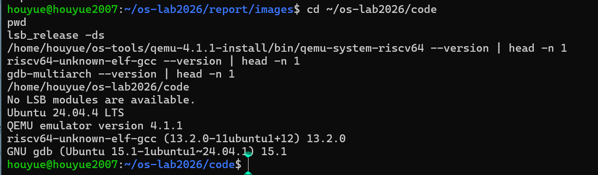
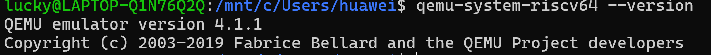
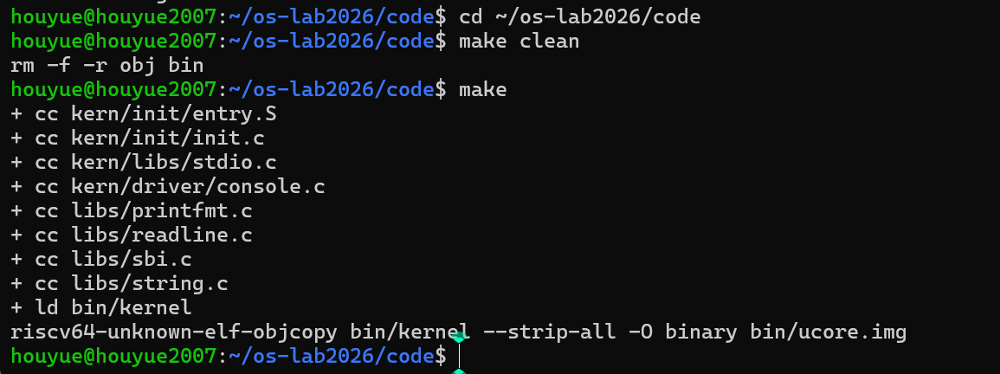
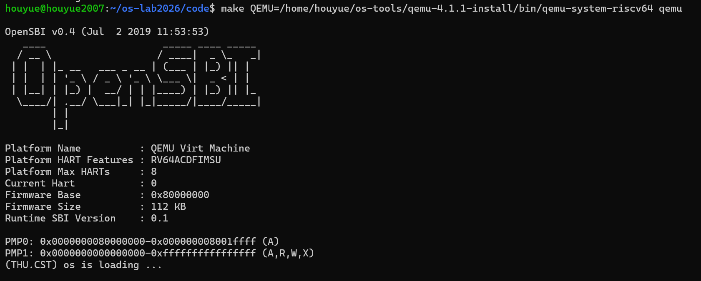
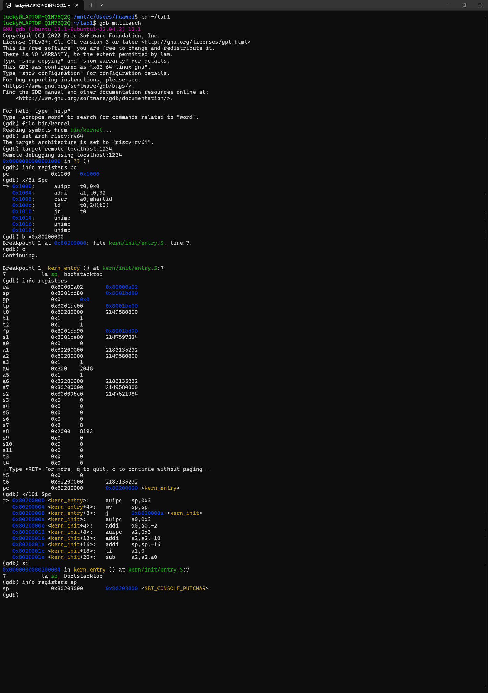

# 实验报告

## 实验基本信息

| 项目 | 内容 |
|---|---|
| 实验名称 | Lab 1：比麻雀更小的麻雀（最小可执行内核） |
| 小组成员 | 2511113-侯悦、2512256-付佳、2512322-丁心怡 |
| 完成日期 | 2026-10-09 |

### 小组分工

| 成员 | 实验任务 | 报告任务 |
|---|---|---|
| 2511113-侯悦 | 环境核验、编译与启动验证 | 汇总环境、整体流程、核心模块、测试结果与总结，组织仓库提交 |
| 2512256-付佳 | 练习1：入口汇编与启动栈分析 | 整理两条入口指令的操作、目的及相关宏定义 |
| 2512322-丁心怡 | 练习2：GDB启动流程验证 | 整理调试过程、复位指令、断点和寄存器观察结果 |

## 一、实验目的

1. 理解最小内核从处理器复位到执行内核初始化函数的启动过程，区分复位代码、固件和内核的职责。
2. 理解交叉编译、链接和镜像生成的关系，掌握内核入口与装载地址的对应关系。
3. 分析启动栈初始化、BSS清零和控制台输出的核心代码，说明汇编入口为C代码建立的运行条件。
4. 使用QEMU与GDB验证复位地址、内核入口和栈指针变化，并通过实际观察回答两项练习的问题。

本实验以提供的最小内核实现为分析对象，通过阅读、编译、运行和调试完成验证，不新增或修改实验源码。

## 二、实验环境

### 2.1 构建与运行环境

| 项目 | 配置 |
|---|---|
| 宿主环境 | Windows，通过WSL运行Ubuntu |
| Ubuntu版本 | Ubuntu 24.04.4 LTS |
| 交叉编译器 | riscv64-unknown-elf-gcc 13.2.0 |
| 已安装调试器 | gdb-multiarch 15.1 |
| 模拟器 | QEMU 4.1.1 |
| QEMU程序路径 | `/home/houyue/os-tools/qemu-4.1.1-install/bin/qemu-system-riscv64` |
| 实验代码目录 | `/home/houyue/os-lab2026/code` |
| 固件配置 | `-bios default`，启动输出为OpenSBI v0.4 |
| 固件报告的SBI接口版本 | Runtime SBI Version 0.1 |

### 2.2 GDB调试环境

启动流程调试在另一台WSL环境中完成，实际记录如下。路径和调试器版本分别按所在机器记录。

| 项目 | 配置 |
|---|---|
| 终端环境 | Windows上的WSL终端 |
| 实验目录 | `~/lab1` |
| 模拟器 | `qemu-system-riscv64`，版本4.1.1 |
| 调试器 | gdb-multiarch 12.1 |
| 目标架构 | `riscv:rv64` |
| 调试连接 | `localhost:1234` |

两套环境的QEMU版本均为4.1.1。QEMU版本、OpenSBI固件版本和固件报告的SBI接口版本分别描述模拟器、固件实现和服务接口，不能相互替代。

### 2.3 AI工具使用记录

| 成员 | AI工具 | 底层模型 | 辅助用途 |
|---|---|---|---|
| 2511113-侯悦 | ChatGPT | GPT-6.1 Sol | 辅助环境排查、启动原理理解、报告组织与文字整理 |
| 2512256-付佳 | ChatGPT | GPT-5.6 Sol | 辅助入口指令分析、源码宏定义核对与GDB操作学习 |
| 2512322-丁心怡 | DeepSeek | DeepSeek-V3 | 辅助分析练习2运行过程中的报错，并参考建议排查问题 |

AI用于学习、报错排查和说明辅助。实验结论依据源码、实际版本输出、编译日志和调试截图核对。本实验没有代码生成任务，`prompt.md`保留为空文件。

## 三、实验整体逻辑分析

### 3.1 构建过程：从源码到可装载镜像

构建首先将C源码和入口汇编生成RISC-V目标文件，再依据链接脚本生成`bin/kernel`，最后通过`objcopy`生成`bin/ucore.img`。

`bin/kernel`是ELF文件，包含符号和调试信息，供GDB定位函数、变量与源代码。`bin/ucore.img`是本次QEMU启动命令使用的原始二进制镜像。两者来自同一份构建结果，但在启动和调试中的用途不同。

链接脚本通过`ENTRY(kern_entry)`指定入口，通过`BASE_ADDRESS = 0x80200000`安排内核地址。Makefile中的`-device loader,file=bin/ucore.img,addr=0x80200000`指定镜像装载位置。链接地址与实际装载地址一致，使代码中的地址引用能够对应实际内存位置。

### 3.2 启动过程：逐步建立执行条件

| 阶段 | 操作 | 为什么需要先完成该阶段 |
|---|---|---|
| 镜像准备 | QEMU准备模拟硬件、固件与内核镜像 | CPU执行前需要有对应的代码和内存内容 |
| 复位引导 | CPU从`0x1000`开始执行MROM复位代码 | 准备启动参数，取得下一阶段入口并跳转 |
| 固件执行 | OpenSBI进行初始化并移交控制权 | 为内核运行提供固件服务和启动约定 |
| 内核汇编入口 | `kern_entry`建立SP，转入`kern_init` | C函数调用需要合法的栈空间 |
| C初始化 | 清零`edata`到`end`的区域 | 保证该范围内的零初始化数据符合运行要求 |
| 输出与保持运行 | 输出启动信息，进入无限循环 | 验证内核已运行，并避免返回到无后续处理的入口 |

本实验的控制流为：CPU复位、执行MROM代码、进入OpenSBI、进入`kern_entry`、建立内核栈、执行`kern_init`、输出信息并持续循环。

在本实验的具体启动配置中，QEMU的loader负责预装载内核镜像，OpenSBI负责初始化与控制权交接。镜像装载和CPU跳转到镜像入口是两个不同动作。

## 四、实验内容与实现

### 4.1 核心模块与函数分析

#### 4.1.1 链接布局

`tools/kernel.ld`确定程序入口与各段布局。`.text`保存代码，`.rodata`保存只读数据，`.data`与`.sdata`保存已初始化数据，`.bss`及相关小数据段保存需要零初始化的数据。

链接脚本在数据段之后定义`edata`，在BSS之后定义`end`。这两个符号用于表示清零范围的边界，不是动态申请的内存块。数据段按`0x1000`字节对齐，启动栈位于入口汇编声明的`.data`区域。

#### 4.1.2 内核初始化函数

`kern/init/init.c`中的核心代码为：

```c
int kern_init(void) __attribute__((noreturn));

int kern_init(void) {
    extern char edata[], end[];
    memset(edata, 0, end - edata);

    const char *message = "(THU.CST) os is loading ...\n";
    cprintf("%s\n\n", message);
    while (1)
        ;
}
```

`extern char edata[], end[]`引用链接脚本定义的边界，`end - edata`得到需要清零的字节数。`memset`清零该范围，其中包含BSS，使其中的零初始化对象具有正确初值。

随后，`cprintf`输出启动信息。`noreturn`声明该函数不会正常返回，末尾的无限循环保持内核运行。因此，输出之后没有新的终端信息与源码行为一致。

#### 4.1.3 控制台输出

| 函数或符号 | 文件 | 核心作用 |
|---|---|---|
| `kern_entry` | `kern/init/entry.S` | 建立启动栈并进入C初始化函数 |
| `kern_init` | `kern/init/init.c` | 清零相关数据、输出信息并持续循环 |
| `cprintf`、`vcprintf` | `kern/libs/stdio.c` | 接收可变参数，组织格式化输出 |
| `vprintfmt` | `libs/printfmt.c` | 解析格式字符串，通过回调输出字符 |
| `cputch` | `kern/libs/stdio.c` | 输出单个字符并累计字符数 |
| `cons_putc` | `kern/driver/console.c` | 将字符交给SBI输出接口 |
| `sbi_console_putchar`、`sbi_call` | `libs/sbi.c` | 设置服务号与参数，执行`ecall`请求固件服务 |

输出调用关系为：`cprintf` → `vcprintf` → `vprintfmt` → `cputch` → `cons_putc` → `sbi_console_putchar` → `sbi_call` → `ecall` → OpenSBI控制台服务。

`cprintf`通过`va_start`和`va_end`处理可变参数；`vcprintf`初始化字符计数并调用格式化函数；`cputch`将每个字符交给控制台接口，同时递增计数。

本实现使用旧版SBI字符输出接口。`SBI_CONSOLE_PUTCHAR`的值为1，`sbi_call`把服务号放入`x17/a7`，把字符等参数放入`x10/a0`、`x11/a1`和`x12/a2`，再执行`ecall`。控制台输出由固件服务完成，内核没有在此路径中直接实现完整的串口驱动。

### 4.2 练习1：理解内核启动中的程序入口操作

**负责人：** 2512256-付佳。

入口汇编的相关代码为：

```asm
kern_entry:
    la sp, bootstacktop
    tail kern_init

.section .data
    .align PGSHIFT
    .global bootstack
bootstack:
    .space KSTACKSIZE
    .global bootstacktop
bootstacktop:
```

#### 4.2.1 `la sp, bootstacktop`完成什么操作，目的是什么？

`la`是加载地址的伪指令。该指令把符号`bootstacktop`的地址写入SP，建立内核自己的启动栈。

栈空间已经由`.space KSTACKSIZE`预留：`bootstack`标识低地址边界，`bootstacktop`标识高地址边界。SP的赋值不是运行时分配栈，也不是读取栈顶地址处的数据。

本实现的宏定义为`KSTACKPAGE=2`、`PGSIZE=4096`、`KSTACKSIZE=KSTACKPAGE*PGSIZE`，因此栈大小为8192字节，即8 KiB。`PGSHIFT=12`，RISC-V汇编中的`.align 12`表示按`2^12=4096`字节对齐。

栈向低地址增长，初始SP指向高地址边界。进入C代码后，函数调用、寄存器保存和局部数据可能使用栈，因此需要在进入`kern_init`之前建立合法SP。标准调用约定要求函数入口的SP满足16字节对齐；本次栈布局也满足这一要求。

#### 4.2.2 `tail kern_init`完成什么操作，目的是什么？

`tail`是尾调用伪指令，把控制权转交给`kern_init`，不为这次转移建立新的返回地址。它不负责清零RA。

`kern_entry`完成SP初始化后没有后续任务，`kern_init`又不会正常返回，因此该控制转移符合启动流程。进入C函数后，由C函数继续进行数据初始化和输出。

本次入口反汇编中，`tail`对应跳往`kern_init`的`j`指令。该跳转本身不改变SP；后续C函数的序言与函数调用可能继续调整SP。

### 4.3 练习2：使用GDB验证启动流程

**负责人：** 2512322-丁心怡。

#### 4.3.1 调试操作

在实验代码目录中执行`make debug`。该目标使用`-s -S`：`-s`开启TCP 1234调试端口，`-S`使客体CPU在开始执行前暂停。

在另一个终端的同一代码目录中启动`gdb-multiarch`，依次执行：

```gdb
file bin/kernel
set arch riscv:rv64
target remote localhost:1234
info registers pc
x/8i $pc
b *0x80200000
c
info registers
x/10i $pc
si
info registers sp
x/5i $pc
```

`file`加载内核ELF的调试符号，`set arch`设置目标架构，`target remote`连接模拟器。首次连接时PC为`0x1000`。复位区域不属于内核ELF的符号范围，因此这里显示`??`不代表连接失败。

检查复位代码后，在`0x80200000`设置地址断点并继续运行。程序停止在`kern_entry`，随后使用寄存器检查和单指令执行观察入口操作。

#### 4.3.2 最初执行的指令位于什么地址？

本次QEMU virt模拟平台的复位PC为`0x1000`，对应MROM复位代码区域。最初五条引导指令分别位于`0x1000`、`0x1004`、`0x1008`、`0x100c`和`0x1010`。这一复位地址是本模拟平台的配置，不能推广为所有RISC-V硬件的统一复位地址。

#### 4.3.3 这些指令主要完成哪些功能？

| 地址 | 实际反汇编 | 功能 |
|---|---|---|
| `0x1000` | `auipc t0,0x0` | 以当前PC为基准，使`t0=0x1000` |
| `0x1004` | `addi a1,t0,32` | 使`a1=0x1020`，指向复位向量后的设备树数据，准备启动参数 |
| `0x1008` | `csrr a0,mhartid` | 读取当前hart编号并放入`a0` |
| `0x100c` | `ld t0,24(t0)` | 从`0x1018`读取64位的下一阶段入口地址到`t0` |
| `0x1010` | `jr t0` | 跳到该入口，将控制权交给下一阶段 |

这段代码主要准备启动参数、读取下一阶段入口并跳转。`0x1018`是保存入口地址的数据位置，不是最终跳转目标。根据本次固件配置，下一阶段为OpenSBI，固件输出的基址为`0x80000000`。

`x/8i`把连续内存按指令解码，因此图中跳转指令之后的填充和入口地址数据可能显示为`unimp`。正常引导在`jr t0`处转移控制，不顺序执行这些数据；该显示不是运行报错。

#### 4.3.4 内核入口与SP变化

| 检查点 | PC | SP | 结论 |
|---|---|---|---|
| 首次连接 | `0x1000` | 本检查点关注PC | 模拟CPU暂停在复位入口 |
| 内核入口断点 | `0x80200000` | `0x8001bd80` | 已到达`kern_entry`，尚未执行其第一条机器指令 |
| 执行一次`si`后 | `0x80200004` | `0x80203000` | 已执行入口第一条机器指令，SP变为内核栈顶地址 |

内核入口的实际反汇编为：

```asm
0x80200000 <kern_entry>:   auipc sp,0x3
0x80200004 <kern_entry+4>: mv    sp,sp
0x80200008 <kern_entry+8>: j     0x8020000a <kern_init>
```

本次构建中，`la sp,bootstacktop`展开为前两条机器指令。第一条`auipc`把当前PC加上`0x3000`，得到`0x80203000`；第二条`mv sp,sp`不改变该值。之后的`j`转入`kern_init`。

`si`按机器指令执行。因此，一次`si`后PC位于`0x80200004`，说明执行了第一条机器指令，不能将其解释为已经执行`tail`或已经进入`kern_init`。入口断点和SP变化共同验证了进入内核与建立内核启动栈的过程。

### 4.4 代码实现与提示词说明

本实验没有新增或修改函数，也没有代码实现迭代。两项练习均通过原实现的分析和调试完成。代码生成提示词不适用，`report/prompt.md`为空文件。

## 五、测试与验证

### 5.1 截图与验证目标

正文保留五张运行相关截图，每张对应明确的验证目标。源码及宏定义已在正文中说明，并随完整源码提交，不重复使用源码截图代替分析。

| 图号 | 文件 | 证明的内容 |
|---|---|---|
| 图1 | `01-env.png` | 构建环境中的系统、交叉编译器、调试器与QEMU版本 |
| 图2 | `07-ex2-qemu-version.png` | GDB调试环境实际使用QEMU 4.1.1 |
| 图3 | `02-build.png` | 编译、链接和镜像生成完成 |
| 图4 | `03-boot.png` | OpenSBI输出及内核启动字符串，证明内核已运行到输出代码 |
| 图5 | `04-gdb-reset.png` | 初始PC、复位指令、内核入口断点与执行指令后的SP变化 |

### 5.2 环境版本验证

构建环境输出Ubuntu 24.04.4 LTS、riscv64-unknown-elf-gcc 13.2.0、GNU GDB 15.1与QEMU 4.1.1。调试环境执行`qemu-system-riscv64 --version`，同样输出QEMU 4.1.1。





### 5.3 编译与镜像生成

在构建环境的代码目录执行：

```bash
cd ~/os-lab2026/code
make clean
make
```

输出包含各C文件和`entry.S`的编译、`bin/kernel`的链接及`bin/ucore.img`的生成。命令返回终端提示符，未出现编译错误。该结果证明源码可完成构建，并生成后续启动与调试所需文件。



### 5.4 内核启动与控制台输出

执行：

```bash
make QEMU=/home/houyue/os-tools/qemu-4.1.1-install/bin/qemu-system-riscv64 qemu
```

启动输出显示OpenSBI v0.4、固件基址`0x80000000`和内核字符串：

```text
(THU.CST) os is loading ...
```

该字符串由`kern_init`中的`cprintf`输出。因此，结果证明启动流程已进入内核C代码并完成控制台输出。随后持续运行与`while (1)`一致。

命令行中的`QEMU=`只选择本机的模拟器程序，启动目标及镜像装载参数仍由原Makefile提供。



### 5.5 GDB启动流程验证

图5显示首次连接时PC为`0x1000`及复位处的五条指令；继续运行后，断点命中`0x80200000`的`kern_entry`；执行一次`si`后，PC为`0x80200004`，SP为`0x80203000`。

该结果分别验证复位入口、内核入口和入口第一条机器指令造成的SP变化，与第4.3节的分析一致。



### 5.6 测试范围与结论

编译、镜像生成、内核输出、复位指令分析、内核入口断点和SP变化均已完成验证。现有结果覆盖本实验两项练习的问题与操作目标。

代码包的Makefile包含`grade`目标，但该目标调用的`tools/grade.sh`不在提供的代码包中。因此，本次没有自动评分成绩，测试结论依据上述实际构建与调试记录，不将其表述为自动评分通过。

## 六、实验总结与收获

### 6.1 重要知识点与OS原理的对应关系

| 实验知识点 | 本实验中的含义 | 对应OS原理及关系 | 范围与差异 |
|---|---|---|---|
| 分阶段启动 | 复位代码、固件和内核依次接管控制流 | 系统引导通过各阶段建立下一阶段的运行条件 | 本实验使用预装载镜像，没有完整磁盘引导流程 |
| 栈与调用约定 | 预留8 KiB栈并设置SP，为C函数提供运行栈 | 函数调用需要合法栈和约定的寄存器状态 | 这里只建立启动栈，没有实现进程栈或上下文切换 |
| 链接与数据初始化 | 链接脚本安排各段，内核清零BSS相关范围 | 程序装载和运行时初始化共同保证地址与数据初值正确 | 尚未实现用户程序的ELF装载器与地址空间管理 |
| 特权级与固件服务 | 内核通过SBI接口及`ecall`请求输出服务 | 不同特权层的软件通过规定接口交互 | SBI服务与用户进程向内核发起的系统调用层次不同 |
| 分层输出 | 格式化、字符输出、固件接口逐层衔接 | I/O抽象将上层输出需求与底层设备操作分离 | 本实验使用固件字符服务，没有完整设备驱动和中断处理体系 |

### 6.2 本实验尚未覆盖的重要OS知识

本实验尚未实现进程与线程管理、调度、完整页表和虚拟内存管理、用户态程序、用户进程系统调用、同步互斥、文件系统以及完整的设备中断处理。

因此，启动字符串证明最小内核可以执行并输出，不能据此认为已经具备完整操作系统的管理功能。

### 6.3 实验收获与AI辅助学习经验

源码阅读说明程序应当完成什么操作，构建与GDB记录说明本次实际发生了什么。将两者结合，可以解释为什么先初始化SP、为什么清零BSS，以及为什么单条伪指令可能对应多条机器指令。

AI能够辅助概念理解和文字整理，但版本、地址、寄存器值及测试是否执行需要依据真实记录核对。尤其需要区分QEMU与OpenSBI的版本、镜像装载与控制权交接、源代码伪指令与实际单步执行的机器指令。

本实验完成了从源码构建、固件交接、内核入口到输出验证的完整学习过程，为后续内存管理和进程管理实验建立了基本的启动与调试认知。

### 参考资料

1. 实验提供的Lab1源码、练习说明与实验报告模板。
2. [RISC-V ABI：寄存器与调用约定](https://riscv-non-isa.github.io/riscv-elf-psabi-doc/)。
3. [GNU assembler：RISC-V汇编指令与对齐指令说明](https://sourceware.org/binutils/docs/as/RISC_002dV_002dDirectives.html)。
4. [QEMU：GDB调试参数](https://www.qemu.org/docs/master/system/gdb.html)。
5. [QEMU复位向量代码说明](https://lists.gnu.org/archive/html/qemu-riscv/2020-07/msg00064.html)。
