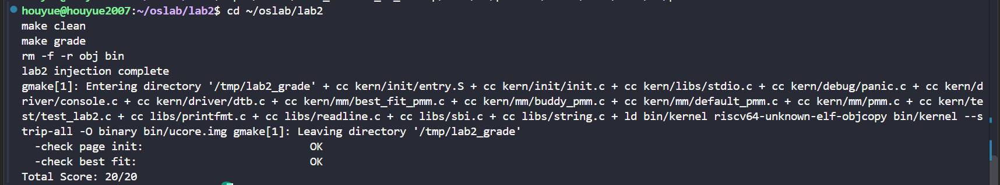
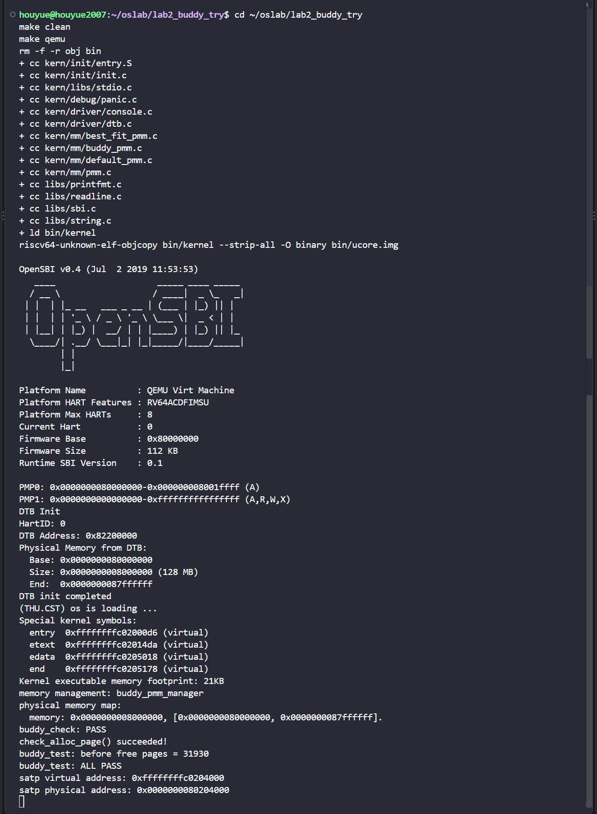
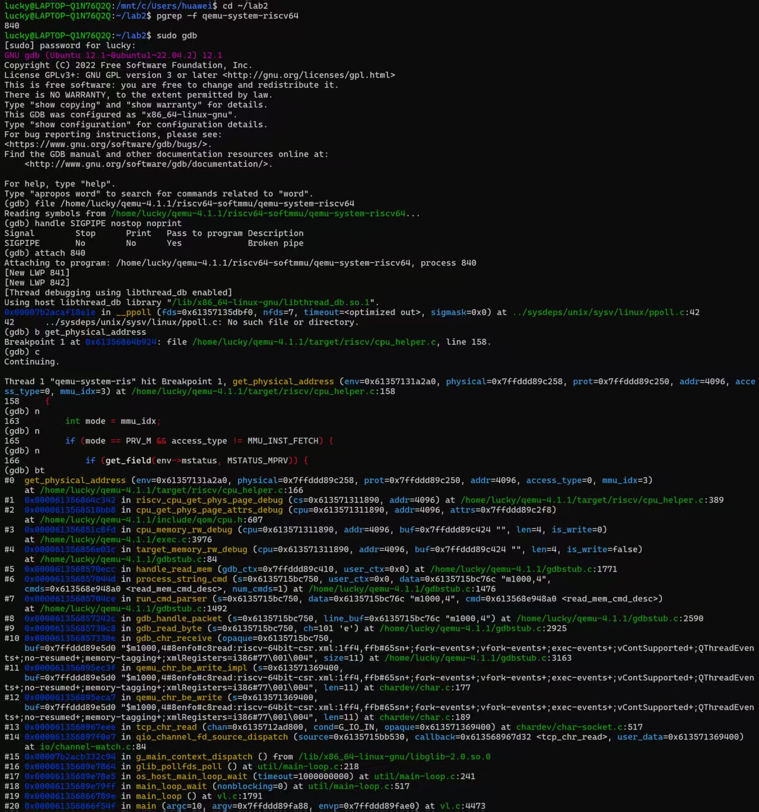
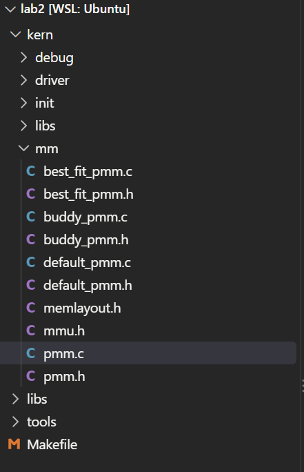
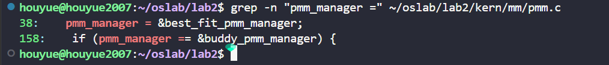

# lab2 实验报告

## 实验基本信息

| 项目   | 内容                                |
| ---- | --------------------------------- |
| 实验名称 | lab2                              |
| 小组成员 | 2511113-侯悦、2512256-付佳、2512322-丁心怡 |
| 完成日期 | 2026-10-25                        |

### 小组分工

| 成员          | 负责的练习/模块                                                 |
| ----------- | -------------------------------------------------------- |
| 2511113-侯悦  | 物理内存探测与 `page_init()`；Page 描述符数组初始化；三人代码整合、统一环境测试及实验报告汇总 |
| 2512256-付佳  | First-Fit 原理分析；Best-Fit 物理页分配器的实现、接入与测试                  |
| 2512322-丁心怡 | Buddy System 物理页分配器、扩展测试以及 GDB 调试演示                      |

---

## 一、实验目的

本实验的主要目标如下：

1. 理解 RISC-V uCore 中物理内存的发现过程，以及设备树提供的内存基址和容量如何转化为内核可管理的物理页范围。
2. 理解 `struct Page` 描述符数组、物理页号、物理地址和内核虚拟地址之间的关系。
3. 掌握物理页分配器统一接口 `struct pmm_manager` 的作用，以及初始化、分配、释放、统计和自检的完整调用流程。
4. 理解 First-Fit、Best-Fit 与 Buddy System 三种物理内存管理策略的工作方式、适用场景和碎片特征。
5. 理解页表建立所依赖的物理页分配基础，并认识虚拟地址到物理地址映射与物理内存分配之间的区别。
6. 学习使用 AI 编程工具完成需求分析、提示词设计、代码生成、人工审查、编译测试和迭代修正。

---

## 二、实验环境

### 2.1 开发与运行环境

| 项目     | 配置                          |
| ------ | --------------------------- |
| 操作系统   | Windows + WSL Ubuntu        |
| 目标体系结构 | RISC-V 64                   |
| 模拟器    | QEMU 4.1.1                  |
| 固件     | OpenSBI v0.4                |
| 编辑器    | Visual Studio Code（WSL 工作区） |
| 构建与测试  | `make qemu`、`make grade`    |

实验中曾误用系统自带 QEMU 8.2.2，对应 OpenSBI v1.3。内核只运行到 OpenSBI 阶段，评分脚本无法看到测试输出。将 PATH 调整为课程工具链中的 QEMU 4.1.1 后，内核正常启动，`make grade` 得到 20/20。

### 2.2 AI 编程工具

| 成员          | AI 编程工具                                             | 底层模型                | 用途                                |
| ----------- | --------------------------------------------------- | ------------------- | --------------------------------- |
| 2511113-侯悦  | Claude Code for VS Code，经 CC Switch 接入 DeepSeek API | DeepSeek-V4.1-Flash | `page_init()` 需求梳理、代码补全、编译诊断与整合测试 |
| 2512256-付佳  | Codex                                               | GPT-6.1-sol         | First-Fit 分析、Best-Fit 实现、测试与材料整理  |
| 2512322-丁心怡 | Claude Code，经 DeepSeek API 接入                       | DeepSeek-V4.1-Flash | Buddy System 实现、测试设计与调试分析         |

---

## 三、实验整体逻辑分析

### 3.1 本章逻辑主线

Lab 2 围绕“如何把机器提供的一段物理内存转化为内核可以安全分配和回收的页框”展开。其主线可概括为：

```text
设备树给出物理内存范围
        ↓
page_init 建立 Page 描述符布局并排除内核占用
        ↓
init_memmap 把剩余完整页交给物理页分配器
        ↓
alloc_pages/free_pages 通过 pmm_manager 完成分配和回收
        ↓
页表代码使用分配得到的物理页建立虚拟地址映射
```

物理页分配器不直接负责虚拟地址翻译；它负责提供可用的物理页框。页表负责保存虚拟页到物理页的映射，两者在功能上不同，但页表页及被映射页面都依赖物理页分配器提供内存。

### 3.2 功能的逐步实现

1. **选择物理内存管理器。** `pmm_init()` 首先调用 `init_pmm_manager()`，确定后续统一接口实际转发给哪个分配算法。
2. **探测和初始化物理内存。** `page_init()` 从设备树读取物理内存基址和大小，建立 `va_pa_offset`、`npage` 与 `pages`，排除 OpenSBI、内核镜像和 Page 描述符数组占用的区域。
3. **登记空闲页。** `page_init()` 将页对齐后的剩余区间交给 `init_memmap()`，再由当前 `pmm_manager` 的 `init_memmap` 实现建立空闲块数据结构。
4. **完成分配与释放策略。** First-Fit 选择第一个可用块；Best-Fit 选择最小的可用块；Buddy 把空闲内存组织为 2 的幂大小的块，并进行分裂与伙伴合并。
5. **自检与评分。** `check_alloc_page()` 调用管理器的 `check` 函数；评分脚本额外验证 `page_init()` 状态和 Best-Fit 管理器选择。
6. **页表基础。** 在物理页管理可用后，内核可以为页表申请物理页，并通过 SATP 等机制启用地址转换。

---

## 四、实验内容与实现

### 4.1 物理内存探测与 Page 描述符初始化

**负责人：2511113-侯悦**

#### 4.1.1 Spec 与核心函数

需要实现或修改的接口：

```c
static void page_init(void);
```

行为规格如下：

- **Pre-Condition：** 设备树和内核边界符号可用，物理内存尚未登记给分配器。
- **Post-Condition：** `va_pa_offset`、`npage` 和 `pages` 正确建立；不可分配页保持保留状态；剩余完整页面通过 `init_memmap()` 交给当前物理页管理器。
- **正常情况：** 使用 `get_memory_base()` 和 `get_memory_size()` 取得物理内存范围，并把上界裁剪到 `PHYSICAL_MEMORY_END`。
- **描述符布局：** `pages` 放在内核镜像结尾之后的页对齐地址，每个可管理物理页对应一个 `struct Page`。
- **空闲范围：** 起点必须位于内核镜像和 Page 描述符数组之后，终点向下按页对齐；只有至少存在一个完整页时才能调用 `init_memmap()`。
- **异常情况：** 设备树信息无效、范围为空或地址计算越界时终止初始化，避免将保留页误登记为空闲页。

#### 4.1.2 最终提示词

```markdown
[PROMPT]
**任务**：修改 `kern/mm/pmm.c` 中的 `page_init()`，完成物理内存探测、Page 描述符数组布局、保留页初始化和剩余空闲页注册。
**操作要求**：必须修改项目中的实际文件；保留已有代码与责任标记，只补充 `//lab2 function1 2511113` 对应功能，不修改分配算法和其他成员模块。
**输出要求**：使用工程中的真实宏、全局变量和辅助函数，不引入无关接口；完成后说明关键状态和测试结果。

[RELY]
- 设备树接口：`get_memory_base()`、`get_memory_size()`。
- 地址与页宏：`KERNBASE`、`PHYSICAL_MEMORY_OFFSET`、`PHYSICAL_MEMORY_END`、`PGSIZE`、`ROUNDUP`、`ROUNDDOWN`、`PADDR`、`KADDR`、`PPN`。
- 全局状态：`va_pa_offset`、`npage`、`pages`、内核结束符号 `end`。
- Page 接口：`SetPageReserved`、`set_page_ref`、`init_memmap`、`panic`、`cprintf`。

[GUARANTEE]
必须实现：
```c
static void page_init(void);
```
不得覆盖 `pmm_manager` 选择、Best-Fit、Buddy 或评分文件。

[SPECIFICATION]
## page_init
**Pre-Condition**：设备树已初始化，能够提供内存基址与大小。
**Post-Condition**：全局地址偏移、可管理总页数、Page 描述符数组和空闲物理页范围均处于一致状态。
**Case 1**：设备树信息有效时，计算 `[mem_base, mem_end)`，并将 `mem_end` 限制在 `PHYSICAL_MEMORY_END` 内。
**Case 2**：设备树返回零大小、范围回绕或没有可用完整页时，使用 `panic()` 终止或不调用 `init_memmap()`。
**Case 3**：将 `pages` 放置在 `ROUNDUP(end, PGSIZE)` 之后，初始化所有 Page 描述符为保留态。
**Case 4**：空闲区起点取 Page 描述符数组物理末尾和内存基址对齐值中的较大者，终点取 `ROUNDDOWN(mem_end, PGSIZE)`；仅当起点小于终点时调用一次 `init_memmap()`。
**Requirements**：按照项目既有格式输出探测到的物理内存范围，不改变其他模块公开接口。
```

#### 4.1.3 实现理解

`page_init()` 最重要的工作不是简单地获得“128MB”这一数值，而是准确划分已占用区与可分配区：

1. 设备树给出的基址和长度用于确定实际物理内存范围。
2. `va_pa_offset` 表示内核虚拟地址和物理地址之间的固定偏移，用于 `PADDR`、`KADDR` 等转换。
3. `npage` 表示可管理物理页号的上界，不等同于当前空闲页数量。
4. `pages` 是 Page 描述符数组，不是物理页本身；数组元素记录对应页框的标志、引用计数、块长度和链表节点。
5. OpenSBI、内核镜像和 `pages` 自身占用的页面不能再次交给分配器。
6. 只有排除已用区并按页对齐后的区间才能调用 `init_memmap()`。

#### 4.1.4 实现迭代

- 第一阶段先确认 `page_init()` 的职责边界，避免只根据函数名生成缺少系统语义的代码。
- 第二阶段补充设备树异常、物理上界裁剪、Page 描述符空间和页对齐要求。
- 第三阶段单独编译 `kern/mm/pmm.c`，确认本模块无编译错误；随后与 Best-Fit 整合，由评分脚本同时验证初始化状态和算法选择。
- 最终结果：`make grade` 中 `check page init: OK`。

---

### 4.2 First-Fit 分析与 Best-Fit 实现

**负责人：2512256-付佳**

#### 4.2.1 Spec 与核心接口

```c
static void best_fit_init(void);
static void best_fit_init_memmap(struct Page *base, size_t n);
static struct Page *best_fit_alloc_pages(size_t n);
static void best_fit_free_pages(struct Page *base, size_t n);
static size_t best_fit_nr_free_pages(void);
const struct pmm_manager best_fit_pmm_manager;
```

- **Pre-Condition：** `init_memmap` 接收连续的保留页区间；分配请求 `n > 0`；释放区间确实处于已分配状态。
- **Post-Condition：** 空闲链表、空闲块头页的 `property/PageProperty` 和 `nr_free` 始终一致。
- **分配：** 遍历所有满足 `property >= n` 的空闲块，选取大小最小者；精确匹配时可以提前结束。
- **切分：** 若选中块大于请求，将剩余部分重新标记为空闲块并插入地址有序链表。
- **释放：** 释放块重新插入地址有序链表，依次检查前后相邻块并合并。
- **边界：** 总空闲页数不足或不存在足够大的连续块时返回 `NULL`。

#### 4.2.2 最终提示词

```markdown
[PROMPT]
**任务**：在现有 Lab 2 工程中分析 First-Fit，并实现 `kern/mm/best_fit_pmm.c` 的 Best-Fit 物理页分配模块。
**操作要求**：仅修改 Best-Fit 责任区域和管理器接入点；保留侯悦完成的 `page_init()`、`//lab2 function1 2511113` 责任标记及框架测试，不完成 Buddy 模块。
**输出要求**：直接修改实际文件，以工程现有定义为准，完成后说明 First-Fit 与 Best-Fit 的差异、关键状态和实际测试结果。

[RELY]
- `pmm.h` 中的 `struct pmm_manager` 与 `free_area_t`。
- `memlayout.h` 中的 `struct Page`、`PageProperty`、`SetPageProperty`、`ClearPageProperty`。
- `list.h` 中的双向链表接口与 `le2page`。
- `default_pmm.c` 的 First-Fit 实现和现有 `basic_check`、`best_fit_check` 测试。

[GUARANTEE]
必须实现：
```c
static void best_fit_init(void);
static void best_fit_init_memmap(struct Page *base, size_t n);
static struct Page *best_fit_alloc_pages(size_t n);
static void best_fit_free_pages(struct Page *base, size_t n);
static size_t best_fit_nr_free_pages(void);
const struct pmm_manager best_fit_pmm_manager;
```
辅助函数必须为 `static`，不得改变公开接口或评分脚本。

[SPECIFICATION]
## best_fit_alloc_pages
**Pre-Condition**：`n > 0`，空闲链表状态有效。
**Post-Condition**：返回满足请求的最小空闲块的前 `n` 页；必要时留下一个合法剩余块；`nr_free` 减少 `n`。
**Case 1**：存在精确大小块时直接选取。
**Case 2**：不存在精确块时选取所有可用块中最小的一块。
**Case 3**：没有足够大的连续块时返回 `NULL`。

## best_fit_free_pages
**Pre-Condition**：释放区间合法且当前不是空闲块。
**Post-Condition**：释放区间重新进入按地址排序的空闲链表，并与物理地址连续的前后块合并。
**Requirements**：保持 `property`、`PageProperty`、链表节点和 `nr_free` 一致；保留并通过原有测试。
```

#### 4.2.3 First-Fit 与 Best-Fit

First-Fit 从链表头开始，选择第一个足够大的空闲块，搜索时间通常较短，但可能过早切分较大的块。Best-Fit 遍历所有候选块，选择满足请求的最小块，尽量减少本次切分产生的剩余空间，但遍历成本更高，也可能形成较多难以利用的小碎片。

本实现保持空闲链表按地址排序。地址排序不是 Best-Fit 选择的必要条件，但可以让释放时的前后相邻块合并更加直接。算法通过 `property` 表示空闲块页数，通过 `PageProperty` 表示链表节点是否为空闲块首页，通过 `nr_free` 记录总空闲页数。

#### 4.2.4 实现迭代与问题

- 第一阶段阅读 First-Fit 与框架测试，明确管理器的五个回调和状态不变量。
- 第二阶段实现最小可用块查找、切分和前后合并，并保留原测试代码。
- 第三阶段在统一工程中选择 `best_fit_pmm_manager` 并执行评分。
- 首次评分时编译成功，但 QEMU 8.2.2/OpenSBI v1.3 未进入内核，两个测试输出均缺失并显示 0/20。检查 `.qemu.out`、管理器选择和测试注入位置后，确认不是算法失败。
- 切换到课程要求的 QEMU 4.1.1 后，`check page init` 与 `check best fit` 均为 OK，最终 20/20。



*图 4-1 `page_init` 与 Best-Fit 的官方评分结果*

---

### 4.3 Challenge：Buddy System 物理页分配器

**负责人：2512322-丁心怡**

#### 4.3.1 Spec 与核心接口

```c
static void buddy_init(void);
static void buddy_init_memmap(struct Page *base, size_t n);
static struct Page *buddy_alloc_pages(size_t n);
static void buddy_free_pages(struct Page *base, size_t n);
static size_t buddy_nr_free_pages(void);
static void buddy_check(void);
void buddy_test(void);
const struct pmm_manager buddy_pmm_manager;
```

Buddy System 将空闲内存划分为 `2^order` 页的块，每一阶维护独立空闲链表。申请 `n` 页时向上取整到 2 的幂，并从最小可用高阶块逐级分裂；释放时通过物理页号异或 `1 << order` 计算伙伴地址，只有伙伴合法、空闲且同阶时才能合并。

本实现设置 `MAX_ORDER=10`，因此单次最大连续分配为 1024 页，即 4MB。这是本组实现的设计取舍，不是设备总内存只有 4MB，更高阶块未纳入本实现。
#### 4.3.2 最终提示词一：实现 Buddy 管理器

```markdown
[PROMPT]
**任务**：在 `kern/mm/` 新增 `buddy_pmm.c` 和 `buddy_pmm.h`，实现基于 Buddy System 的物理内存分配模块，并接入现有 `pmm_manager` 框架。
**操作要求**：必须修改项目实际文件；保留现有初始化和 Best-Fit 代码，只增加 Buddy 所需接口和可切换的管理器选择。
**输出要求**：使用下面的 [RELY]、[GUARANTEE] 和 [SPECIFICATION]，实现分配、释放、分裂、合并和空闲页统计。

[RELY]
- `PGSIZE`、`PG_reserved`、`PG_property`。
- `struct Page` 的 `ref`、`flags`、`property`、`page_link`。
- 双向链表接口、`le2page`、`page2ppn`、`set_page_ref`、`panic`。
- Page 描述符数组下标与真实物理页号之间存在 `nbase` 偏移。

[GUARANTEE]
必须实现 `buddy_init`、`buddy_init_memmap`、`buddy_alloc_pages`、`buddy_free_pages`、`buddy_nr_free_pages`、`buddy_check` 和 `buddy_pmm_manager`；允许增加 `static` 辅助函数和内部 `MAX_ORDER`。

[SPECIFICATION]
## buddy_init_memmap
将传入区间清除保留标志，并按起始物理页号对齐和剩余页数拆成尽可能大的 2 的幂块。

## buddy_alloc_pages
将请求页数向上取整到 `2^ceil(log2(n))`；寻找对应阶或更高阶块；高阶块逐级二分，后半块放回低阶链表；超过 `1 << MAX_ORDER` 或无可用块时返回 `NULL`。

## buddy_free_pages
清理已分配页状态，使用 `PPN ^ (1 << order)` 得到伙伴；仅当伙伴在管理范围内、为空闲块头且阶数相同时合并；重复向上合并后放回最终阶链表。

## buddy_nr_free_pages
返回所有阶空闲页数之和，而不是空闲块个数。
```

#### 4.3.3 最终提示词二：测试 Buddy

```markdown
[PROMPT]
**任务**：修改 `kern/mm/buddy_pmm.c`，实现基础自检 `buddy_check` 和扩展测试 `buddy_test`。
**操作要求**：测试使用工程的 `assert` 和 `cprintf`，测试结束后恢复系统状态。
**输出要求**：覆盖单页分配、多页向上取整、释放恢复和超限请求，并输出明确 PASS 信息。

[RELY]
- `assert()`、`cprintf()`、`struct Page`。
- `buddy_alloc_pages`、`buddy_free_pages`、`buddy_nr_free_pages`。

[GUARANTEE]
```c
static void buddy_check(void);
void buddy_test(void);
```

[SPECIFICATION]
## buddy_check
记录初始空闲页数；分别测试申请1页和申请3页（实际占4页）；释放后空闲页数必须恢复。

## buddy_test
验证单页与多页分配、2的幂取整、释放后的计数守恒，以及请求大于 `1 << MAX_ORDER` 时安全返回 `NULL`。使用 `%lu` 和显式类型转换打印 `size_t`。
```

#### 4.3.4 实现与测试理解

- `buddy_init()` 初始化 0 到 `MAX_ORDER` 的链表与计数。
- `buddy_init_memmap()` 按物理页号对齐要求把任意长度空闲区拆为若干合法阶块。
- `buddy_alloc_pages()` 向上取整请求，从低阶向高阶寻找空闲块，并逐级分裂。
- `buddy_free_pages()` 清理页面状态，计算同阶伙伴并逐级合并。
- `buddy_nr_free_pages()` 汇总所有阶记录的空闲页数。
- `buddy_check()` 和 `buddy_test()` 验证基础分配、取整、释放恢复与超限请求。

统一环境中的运行结果显示：

```text
memory management: buddy_pmm_manager
buddy_check: PASS
check_alloc_page() succeeded!
buddy_test: before free pages = 31930
buddy_test: ALL PASS
```



*图 4-2 Buddy 管理器启动、自检及扩展测试结果*

现有测试覆盖了基本分配、2 的幂取整、释放恢复、计数守恒和超限请求。当前版本未单独构造“两个明确相邻的同阶块释放后再次申请更高阶块”的场景；该场景可作为后续边界测试，用于更直接地验证伙伴合并过程，不影响本次实验基础功能的验证结论。

#### 4.3.5 GDB 调试验证

调试演示分为三部分：第一终端启动等待调试的 QEMU；第二终端使用宿主 GDB 附加 QEMU 进程并观察模拟器内部地址翻译；第三终端使用 RISC-V GDB 连接客户机内核。若第三终端出现 `Ignoring packet error` 或远程等待超时，可在 GDB 中输入：

```gdb
set remotetimeout unlimited
```

该命令仅调整 GDB 远程等待时间，不是内核源代码的一部分，也不影响内存管理算法。调试过程中，宿主 GDB 成功附加到 QEMU 进程，在地址转换函数 `get_physical_address` 处命中断点，并通过单步执行和调用栈检查确认调试链路工作正常。



*图 4-3 GDB 附加 QEMU、命中断点并查看调用栈*

---

## 五、代码整合与分配器切换

最终工程同时保留：

```text
kern/mm/default_pmm.c
kern/mm/default_pmm.h
kern/mm/best_fit_pmm.c
kern/mm/best_fit_pmm.h
kern/mm/buddy_pmm.c
kern/mm/buddy_pmm.h
kern/mm/pmm.c
kern/mm/pmm.h
```



*图 5-1 最终工程中保留的 Default、Best-Fit 与 Buddy 管理器文件*

最终评分版本默认选择：

```c
pmm_manager = &best_fit_pmm_manager;
```

并使用条件判断避免在 Best-Fit 模式运行 Buddy 扩展测试：

```c
if (pmm_manager == &buddy_pmm_manager) {
    buddy_test();
}
```



*图 5-2 正式版本的管理器选择与 Buddy 条件测试入口*

### 6.1 测试结果汇总

| 测试                          | 环境/命令                                                                 | 结果                                               |
| --------------------------- | --------------------------------------------------------------------- | ------------------------------------------------ |
| `page_init` 与 Best-Fit 官方评分 | QEMU 4.1.1，`make grade`                                               | `check page init: OK`、`check best fit: OK`、20/20 |
| Buddy 内核运行                  | QEMU 4.1.1，`make qemu`                                                | `buddy_check: PASS`、`buddy_test: ALL PASS`       |
| QEMU/GDB 调试                 | 宿主 GDB 附加 QEMU，设置断点并查看调用栈                                             | 成功命中 `get_physical_address` 断点并单步执行              |
| 最终整合工程复测                    | Best-Fit 为默认，工程中同时编译 `best_fit_pmm.c`、`buddy_pmm.c` 与 `default_pmm.c` | `check page init: OK`、`check best fit: OK`、20/20 |

---

## 七、重要知识点及与OS原理的关系

### 7.1 本实验直接涉及的知识点

1. **物理页框与Page描述符。** 页框是真实物理内存单位；`struct Page` 是内核维护的元数据。二者一一对应，但描述符本身也占用物理内存。
2. **保留页与空闲页。** 固件、内核和元数据占用的页必须标记为保留；只有排除这些区域后的完整页才能进入分配器。
3. **连续分配与外部碎片。** First-Fit和Best-Fit都管理可变长度连续块，长期运行后可能出现外部碎片。
4. **Best-Fit策略。** 尽量选择最小可用块，降低当次切分剩余，但增加搜索时间且可能产生许多小碎片。
5. **Buddy System。** 使用2的幂分块，分裂和合并效率高，伙伴计算简单；代价是请求向上取整产生内部碎片。
6. **虚拟地址与物理地址。** `va_pa_offset` 描述内核直接映射中的固定偏移；页表则提供更一般的逐页映射。固定偏移和页表映射不是同一概念。
7. **页表与物理分配器的关系。** 页表决定地址翻译和权限，物理分配器决定页框归属；建立页表必须先获得保存页表及数据的物理页。

### 7.2 重要但本实验未完整覆盖的OS知识

1. 页面置换算法，如FIFO、Clock和LRU近似。
2. 缺页异常、按需分页、写时复制和交换空间。
3. TLB刷新、一致性及多核shootdown。
4. 用户态与内核态页表权限隔离。
5. NUMA、内存热插拔和区域分配器。
6. 多核环境下物理页分配器的锁与并发正确性。
7. slab/slub等面向小对象的内核内存分配器。

---

## 八、AI协作开发的经验

本实验说明，AI生成代码的质量高度依赖需求是否包含完整的系统语义。仅要求“实现某个函数”会遗漏物理内存边界、保留页、对齐关系、Page描述符自身占用、异常情况和测试状态恢复等关键条件。因此我们使用 `[PROMPT]`、`[RELY]`、`[GUARANTEE]`、`[SPECIFICATION]` 四段式提示词，把任务、真实上下文、必须交付的接口和可验证行为分开描述。

AI输出后仍必须完成以下人工工作：

1. 核对宏、函数签名、数据结构与工程代码是否一致。
2. 检查算法是否维持链表、标志位、块长度和空闲计数之间的不变量。
3. 确认AI没有覆盖其他成员代码、评分文件或责任注释。
4. 通过编译、QEMU运行和评分脚本验证结果，而不是只阅读AI回复。
5. 遇到失败时先区分代码错误、测试接入错误和工具环境错误。例如本次0/20的直接原因是QEMU版本不兼容，而不是Best-Fit算法本身。
6. 让提示词与最终代码保持同步；发现边界条件或测试不足后，应更新提示词和报告。

AI提高了代码阅读、需求整理和问题定位的效率，但最终正确性仍由小组成员通过代码审查和可复现测试负责。

---

## 九、实验总结

本实验从设备树物理内存探测开始，完成Page描述符数组布局和空闲物理页注册，并在统一的 `pmm_manager` 接口下比较、实现了First-Fit、Best-Fit和Buddy System。最终Best-Fit模式通过官方评分，`page_init`和Best-Fit均为OK，总分20/20；Buddy模式在统一环境中完成编译、启动和自检，输出 `buddy_check: PASS` 与 `buddy_test: ALL PASS`。

通过本实验，我们认识到物理内存管理的正确性不仅取决于分配算法，还取决于设备树范围、地址换算、Page元数据布局、保留页排除、对齐和测试环境。通过规范提示词、人工审查、成员间接口约定和实际运行验证，三部分代码最终可以在同一工程中共存并按需切换。
