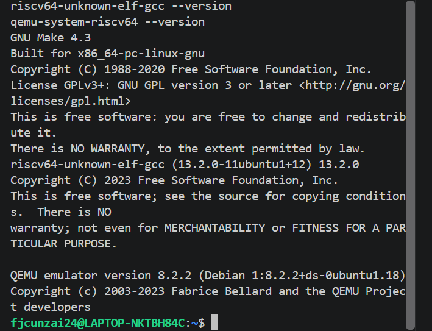
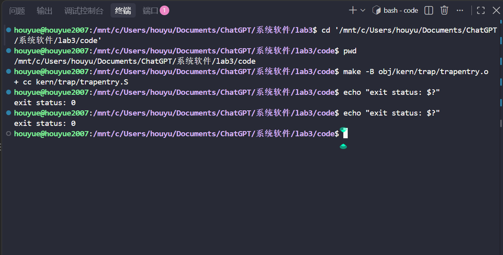
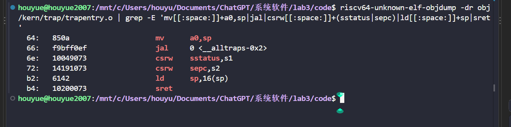
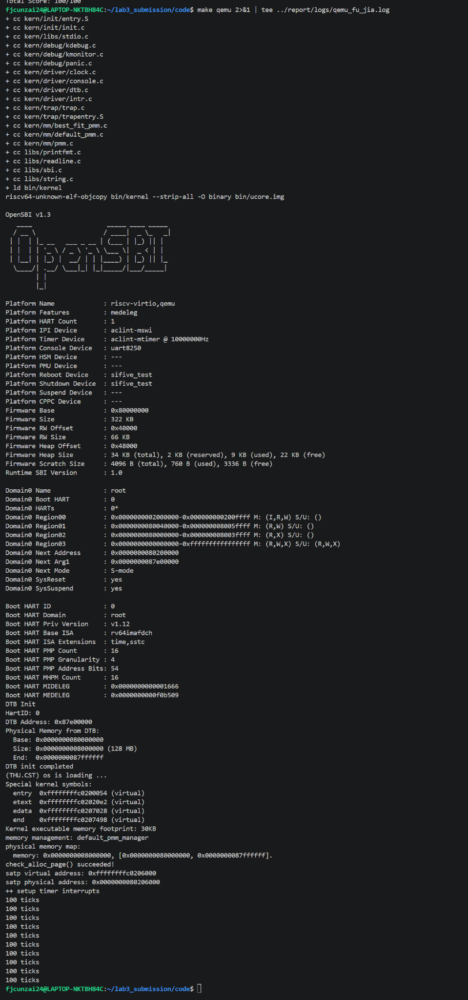
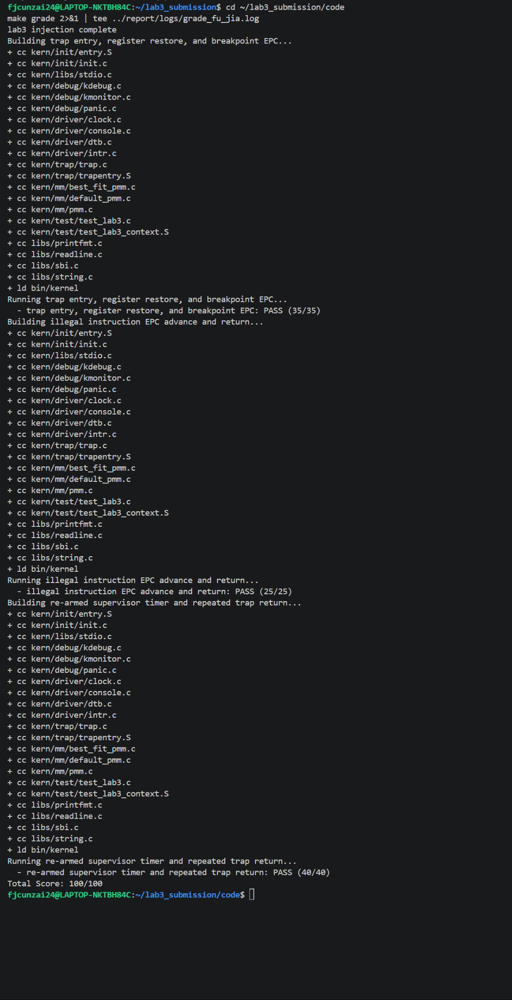

# 实验报告

## 实验基本信息

| 项目   | 内容                                   |
| ---- | ------------------------------------ |
| 实验名称 | Lab3：中断与异常处理                         |
| 小组成员 | 侯悦（2511113）、付佳（2512256）、丁心怡（2512322） |
| 完成日期 | 2026-11-07                           |

### 小组分工

| 成员           | 编程任务                                                        | 主要代码位置                                                 | 实验报告任务                   |
| ------------ | ----------------------------------------------------------- | ------------------------------------------------------ | ------------------------ |
| 侯悦（2511113）  | 实现 `RESTORE_ALL` 和 `__alltraps`，完成 Trap 上下文恢复及汇编入口到 C 函数的连接 | `kern/trap/trapentry.S`                                | Trap 汇编入口、上下文恢复原理、本人测试证据 |
| 付佳（2512256）  | 整理公共工程基线和 Lab2 依赖，实现 `interrupt_handler()` 及持续时钟中断          | `kern/mm/`、`kern/init/entry.S`、`kern/trap/trap.c`、构建脚本 | 公共基线、中断处理、实验环境和小组综合测试结果  |
| 丁心怡（2512322） | 实现 `exception_handler()` 和 16/32 位指令长度判断                    | `kern/trap/trap.c`                                     | 异常处理、指令长度判断及最终报告汇总排版     |

我们基于同一份公共工程并行完成各自模块，再按照“公共基线—统一入口与返回—中断和异常分派”的 Trap 执行链进行整合。

## 一、实验目的

本实验在 Lab2 内存管理的基础上，为 uCore 内核增加中断与异常处理机制。操作系统运行过程中，处理器可能因为外部事件或当前执行的指令而暂时离开原来的执行流程。为了让内核能够处理这些事件，并在处理结束后继续执行原程序，我们需要建立一套完整的 Trap 处理过程。

本次实验围绕 RISC-V 的 Trap 机制展开，我们主要完成以下任务：

1. 设置统一的 Trap 处理入口，使处理器发生中断或异常时能够进入内核指定位置。
2. 保存发生 Trap 时的寄存器和处理器状态，形成 `struct trapframe`。
3. 将 Trap frame 地址传递给 C 语言处理函数，实现汇编入口与 C 语言代码之间的连接。
4. 根据 Trap 原因区分中断和异常，完成时钟中断、非法指令异常和断点异常的处理。
5. 处理结束后恢复原来的执行现场，通过 `sret` 返回到正确的执行位置。

## 二、实验环境

我们在 WSL Ubuntu 22.04 中完成最终验证，工程目录为 `lab3/code`。实验使用 RISC-V 交叉编译工具链编译内核，并通过 QEMU `virt` 机器运行。我们最终执行 `make qemu` 和 `make grade`，分别验证普通启动、时钟中断和课程自动评分。

| 成员  | AI 编程工具                   | 底层模型                | 主要用途                       |
| --- | ------------------------- | ------------------- | -------------------------- |
| 侯悦  | DeepSeek Harness（VS Code） | DeepSeek-V4.1-Flash | 生成并核对 Trap 恢复汇编、调用约定及反汇编结果 |
| 付佳  | Codex                     | GPT-6.1-sol         | 整理公共基线、实现中断处理并完成整体测试       |
| 丁心怡 | Codex                     | GPT-5.6 Luna        | 实现异常处理、指令长度判断并汇总报告         |

实验环境与工具版本截图如下：



## 三、实验整体逻辑分析

### 3.1 整体执行主线


首先，内核通过 `idt_init()` 设置 `stvec`，告诉处理器发生 S 态 Trap 时应该从哪里开始执行。其次，处理器进入汇编入口 `__alltraps`，执行 `SAVE_ALL`，将通用寄存器和相关 CSR 保存到栈上。保存完成后，汇编代码把 Trap frame 的地址作为参数传给 C 函数 `trap()`。

随后，`trap_dispatch()` 根据 `cause` 判断当前事件属于中断还是异常，并分别调用 `interrupt_handler()` 或 `exception_handler()`。中断处理部分主要负责时钟事件的重新设置、计数和输出；异常处理部分主要负责非法指令和断点，并更新异常返回地址。

最后，C 处理函数返回到汇编入口，执行 `RESTORE_ALL` 恢复寄存器和处理器状态，再通过 `sret` 返回。整个过程可以概括为：

| 顺序         | 实现位置                                        | 完成的功能                      |
| ---------- | ------------------------------------------- | -------------------------- |
| 1. 设置入口    | `idt_init()`                                | 设置 `stvec`，指定统一 Trap 入口    |
| 2. 保存现场    | `SAVE_ALL`                                  | 保存通用寄存器、CSR 和原始栈指针         |
| 3. 连接 C 函数 | `__alltraps`、`trap()`                       | 将 Trap frame 地址传入 C 语言处理函数 |
| 4. 分派事件    | `trap_dispatch()`                           | 根据 `cause` 区分中断与异常         |
| 5. 处理事件    | `interrupt_handler()`、`exception_handler()` | 完成时钟中断和指定异常处理              |
| 6. 恢复并返回   | `RESTORE_ALL`、`sret`                        | 恢复处理器现场，返回原执行流             |

这几个阶段必须使用一致的数据布局和调用约定。保存现场时的槽位顺序必须与 `struct trapframe` 对应；汇编传递给 C 函数的地址必须指向正确的帧起始位置；恢复现场时也必须按照保存时的布局取回数据。任一环节不一致，都可能导致寄存器值错误、栈指针错位或返回地址错误。

### 3.2 公共基础：Lab2 内存管理依赖

Lab3 的内核启动过程仍然需要进行物理内存初始化，因此保留了 Lab2 中的部分内存管理实现。公共基线需要补齐 `page_init()` 和 Best-Fit 模块相关依赖，使内核能够建立物理页描述符并管理空闲页面。

`page_init()` 根据设备树提供的物理内存范围初始化页描述符。内核镜像、固件以及页描述符本身占用的区域不能被登记为空闲页；其余可管理范围内的完整页面才加入空闲页管理结构。

迁移 Lab2 代码时，需要结合 Lab3 当前工程的宏定义和数据结构进行适配，不能直接用 Lab2 文件覆盖 Lab3 文件。Lab3 的 `alloc_pages()`、`free_pages()` 和 `nr_free_pages()` 已经包含中断状态保护，因此迁移时需要保留这些保护逻辑。

当前工程仍然使用 `default_pmm_manager`。补齐 Best-Fit 相关源码是为了满足工程中的模块依赖，并不意味着本次运行时切换到了 Best-Fit 管理器。

### 3.3 Trap 相关寄存器

RISC-V 处理器在发生 Trap 时，会通过控制状态寄存器（Control and Status Register，CSR）记录相关状态。本实验主要涉及以下寄存器：

| 寄存器        | 作用                | 本实验中的使用                          |
| ---------- | ----------------- | -------------------------------- |
| `stvec`    | S 态 Trap 处理入口地址   | 在 `idt_init()` 中设置为 `__alltraps` |
| `sepc`     | 保存 Trap 发生时的程序计数器 | 保存到 Trap frame 的 `epc` 字段，返回时恢复  |
| `scause`   | 保存 Trap 原因        | 保存到 `cause` 字段，用于区分中断和异常         |
| `stval`    | 保存与 Trap 相关的附加信息  | 保存到框架中对应的故障地址字段                  |
| `sstatus`  | 保存 S 态处理器状态       | 保存并在返回前恢复                        |
| `sscratch` | S 态软件可用的临时 CSR    | 在现场保存过程中辅助保存原始 `sp`              |

其中，`sepc` 与异常处理关系尤其密切。发生异常时，`sepc` 保存异常指令所在位置；如果异常处理函数需要跳过当前指令，就必须修改 Trap frame 中的 `epc`，使恢复时写回的 `sepc` 指向下一条指令。

### 3.4 Trap frame 布局

`struct trapframe` 是内核保存处理器现场的数据结构。RV64 架构下每个寄存器槽位占 8 字节，本实验的 Trap frame 包含 32 个通用寄存器槽和 4 个 CSR 信息槽，共 36 个槽位、288 字节。

| 槽位   | 字节偏移  | 保存内容                     |
| ---- | ----- | ------------------------ |
| 0—31 | 0—248 | 通用寄存器 `x0`—`x31`         |
| 2    | 16    | 特殊处理：保存 Trap 发生前的原始 `sp` |
| 32   | 256   | `sstatus`                |
| 33   | 264   | `sepc`                   |
| 34   | 272   | 故障附加信息                   |
| 35   | 280   | `scause`                 |

`SAVE_ALL` 建立的内存布局必须与 `struct trapframe` 完全一致。这样 C 语言处理函数拿到 `struct trapframe *tf` 后，才能通过 `tf->epc`、`tf->cause` 等成员访问保存的信息。

`x0` 的值恒为 0，不需要像其他通用寄存器一样恢复。原始 `sp` 则需要特殊处理：分配 Trap frame 后，当前 `sp` 已经指向新帧，因此需要借助 `sscratch` 等保存过程取回发生 Trap 前的栈指针，并放入对应槽位。

## 四、实验内容与实现

本章节按照练习顺序整理了各模块的负责人、接口和最终提示词。完整提示词作为报告附件与代码一同提交，链接可直接打开；后文继续说明功能原理和迭代过程。

| 功能模块            | 负责人 | 核心接口/符号                                                                       | 最终版完整提示词                        |
| --------------- | --- | ----------------------------------------------------------------------------- | ------------------------------- |
| 公共基线与时钟中断       | 付佳  | `page_init()`、Best-Fit、`interrupt_handler(struct trapframe *tf)`              | [完整提示词附件](prompt/2512256付佳.md)  |
| Trap 上下文恢复与统一入口 | 侯悦  | `RESTORE_ALL`、`__alltraps`                                                    | [完整提示词附件](prompt/2511113侯悦.md)  |
| 异常处理            | 丁心怡 | `instruction_length(uintptr_t epc)`、`exception_handler(struct trapframe *tf)` | [完整提示词附件](prompt/2512322丁心怡.md) |

### 4.1 公共基线与 Lab2 依赖

**核心接口：** `page_init()`、Best-Fit 页分配接口、启动页表和构建脚本。

该模块将 Lab2 中仍被 Lab3 启动流程依赖的内存管理实现适配到当前工程，并保留 Lab3 已有的中断保护。启动代码同时保留分页切换所需的低地址恒等映射和高地址内核映射；构建脚本使用与当前 QEMU 环境匹配的内核镜像加载方式。迁移时没有直接覆盖整个旧文件，而是依据当前 `struct Page`、地址宏和公开接口补齐缺失实现。最终 `check_alloc_page() succeeded!`，说明公共基线能够支持后续 Trap 测试。

**迭代过程：** 初次整合时，我们发现旧版 Lab2 代码可能覆盖 Lab3 新增保护逻辑，且分页切换阶段需要额外的低地址映射。因此，我们逐项比对当前工程接口，只迁移必要函数，并通过启动日志验证内存初始化。完整任务约束与修正过程见[提示词附件](prompt/2512256付佳.md)。

### 4.2 `idt_init()`：设置 Trap 入口（框架已有）

`idt_init()` 负责初始化 Trap 处理入口。RISC-V 中，`stvec` 用于指定 S 态 Trap 的入口地址。本实验将 `stvec` 设置为 `__alltraps`，使不同原因引起的 Trap 统一从该汇编入口进入。

统一入口可以避免每种异常或中断都单独编写一套现场保存和恢复流程。进入入口后，内核先保存现场，再根据原因分派给具体处理函数。

### 4.3 `SAVE_ALL`：保存上下文（框架已有）

`SAVE_ALL` 位于 `trapentry.S` 中，负责在进入 C 语言处理函数之前保存处理器现场。它将通用寄存器和相关 CSR 内容写入栈上的 Trap frame。

保存现场的目的，是让 C 处理函数能够使用寄存器而不破坏被中断程序原本的执行状态。因为 C 函数运行时可能使用多个通用寄存器，所以必须先保存这些寄存器原来的值。

保存过程还需要处理原始 `sp`。建立 Trap frame 本身会改变当前栈指针，因此必须把 Trap 发生前的 `sp` 单独保存下来，供返回时恢复。

### 4.4 `RESTORE_ALL`：恢复上下文

**符号与接口：** 汇编宏 `RESTORE_ALL`；输入为 `sp` 指向的完整 `struct trapframe`，输出为恢复后的处理器现场。

`RESTORE_ALL` 与 `SAVE_ALL` 配合，按照 Trap frame 的布局恢复处理器现场。

恢复过程首先从帧中取出 `sstatus` 和 `sepc`，写回对应 CSR；随后恢复通用寄存器。用于暂存 CSR 内容的临时寄存器也必须恢复原值，否则即使其他寄存器恢复正确，仍然会改变被中断程序的执行现场。

`sp` 必须最后恢复。恢复过程需要不断通过当前 `sp` 加偏移访问 Trap frame。如果提前恢复原始 `sp`，当前帧的基址就会改变，后续加载操作便无法继续访问正确位置。

恢复完成后，执行 `sret`。它根据恢复后的处理器状态和 `sepc` 返回，而不是像普通函数的 `ret` 一样只根据通用返回地址寄存器跳转。

**迭代过程：** 生成代码后，我们逐槽对照 `SAVE_ALL` 与 `struct trapframe`，重点检查 CSR 临时寄存器是否会恢复、`sp` 是否最后恢复。随后，我们单独编译 `trapentry.o`，并通过反汇编确认 `csrw sstatus`、`csrw sepc`、最终 `ld sp,16(sp)` 和 `sret` 的顺序。完整提示词见[提示词附件](prompt/2511113侯悦.md)。

### 4.5 `__alltraps`：连接汇编入口与 C 处理函数

**符号与接口：** 汇编入口 `__alltraps` 调用 `void trap(struct trapframe *tf)`；第一个参数按 RISC-V ABI 放入 `a0`。

`__alltraps` 是统一的汇编入口。处理器进入该入口后，先执行 `SAVE_ALL`，在栈上建立 Trap frame。

保存完成时，当前 `sp` 指向 Trap frame 的起始位置。代码通过以下指令传递参数并调用 C 函数：

```asm
mv a0, sp
jal trap
```

按照 RISC-V 函数调用约定，函数的第一个参数通过 `a0` 传递。因此，将 `sp` 放入 `a0`，就把 Trap frame 的地址传给了 `trap(struct trapframe *tf)`。

`trap()` 及其后续分派函数便可以通过指针访问发生 Trap 时保存的现场。C 函数返回后，执行流进入 `__trapret`，再执行 `RESTORE_ALL` 和 `sret`。

汇编模块的实际编译与反汇编检查结果如下：





### 4.6 `trap_dispatch()`：区分中断与异常（框架已有）

`trap_dispatch()` 根据 `tf->cause` 判断当前 Trap 的类型。RISC-V 的 `scause` 最高位用于标识当前事件是中断还是异常，其余位表示具体原因编号。

因此，处理函数需要先判断最高位，再提取具体原因编号。中断与异常的处理方式不同：中断通常由外部事件或计时事件触发，处理后一般返回原来的执行位置；异常由当前指令执行引起，某些异常需要调整返回地址，避免再次执行同一条异常指令。

### 4.7 `interrupt_handler()`：中断分类与时钟处理

**函数签名：** `void interrupt_handler(struct trapframe *tf)`。

`interrupt_handler()` 负责处理中断。进入函数后，先从 `cause` 中区分中断标志和具体中断原因，再根据工程中定义的 `IRQ_*` 常量进行分类。

本实验重点处理 S 态时钟中断，处理过程如下：

1. 调用 `clock_set_next_event()` 设置下一次时钟事件。这样当前时钟中断处理结束后，后续时钟事件仍会继续触发。
2. 将全局计数器 `ticks` 增加一次，记录已经处理的时钟中断次数。
3. 当 `ticks` 达到 `TICK_NUM` 的整数倍时，调用 `print_ticks()` 输出一行 `100 ticks`。
4. 当输出组数达到 `SHUTDOWN_AFTER` 时，调用 `sbi_shutdown()` 关闭系统。

本实验设置 `TICK_NUM=100`、`SHUTDOWN_AFTER=10`。因此，每处理 100 次时钟中断输出一行信息，累计输出 10 行后关机，对应总计 1000 次时钟中断。

其他已定义的软件中断、定时器中断和外部中断根据类型输出对应信息。对于无法识别的中断，输出原因编号并调用 `print_trapframe(tf)`，以便查看当时保存的现场。

时钟中断处理不需要推进 `tf->epc`。时钟事件并不是由当前正在执行的某条指令引起的，处理完成后应继续原来的指令流。

**迭代过程：** 指导书没有明确给出 `SHUTDOWN_AFTER` 数值。我们结合课程测试行为将其设为 10，即每 100 次输出一次、累计输出 10 次后关机。实现时，我们进一步确认每次 S 态时钟中断都先安排下一次事件，其他中断不计入 `ticks`，未知中断打印完整 Trap frame。完整提示词见[提示词附件](prompt/2512256付佳.md)。

### 4.8 `exception_handler()`：非法指令与断点异常

**函数签名：** `static inline uintptr_t instruction_length(uintptr_t epc)`；`void exception_handler(struct trapframe *tf)`。

`exception_handler()` 根据 `tf->cause` 判断异常类型。本实验重点实现两种异常：

- 非法指令异常（Illegal Instruction）：处理器尝试执行不符合指令编码要求的指令时产生。
- 断点异常（Breakpoint）：程序执行断点指令时产生，常用于调试和测试。

对于这两种异常，处理函数先输出异常发生地址，再更新 `tf->epc`，使返回时跳过当前异常指令。如果不修改返回地址，处理器恢复现场后就会再次执行同一条异常指令，导致重复进入异常处理流程。

本实验使用辅助函数 `instruction_length()` 判断异常指令长度。RISC-V 同时支持 16 位压缩指令和 32 位普通指令，不能将所有指令都默认按 4 字节处理。辅助函数读取异常地址处指令的低 16 位，根据最低两位判断长度：

- 最低两位不为二进制 `11`，按 16 位指令处理，长度为 2 字节。
- 最低两位为二进制 `11`，按 32 位指令处理，长度为 4 字节。

因此，处理函数根据判断结果将 `tf->epc` 增加 2 或 4。对于其他异常，则调用 `print_trapframe(tf)` 输出异常现场信息。

**迭代过程：** 初版容易把非法指令和断点都固定推进 4 字节，这会使 16 位压缩指令返回到错误地址。我们最终依据 RISC-V 编码最低两位判断 16/32 位长度，并用四类补充用例验证 EPC 分别增加 2 或 4。完整提示词见[提示词附件](prompt/2512322丁心怡.md)。

### 4.9 练习的 SPEC 与 PROMPT 设计

本实验使用提示词辅助完成代码模块。为了让生成的代码符合当前工程，而不是得到脱离项目上下文的通用代码，我们按照任务目标、已有代码依据、接口约束和具体行为要求组织提示词。三份完整提示词和 SPEC 均保存在 `prompt/` 目录中。

#### 4.9.1 提示词的基本结构

本实验各模块提示词主要采用以下四个部分：

| 部分                | 含义        | 本实验中的内容                   |
| ----------------- | --------- | ------------------------- |
| `[PROMPT]`        | 任务目标与修改范围 | 指定要实现的函数、文件位置、负责人及允许修改范围  |
| `[RELY]`          | 代码依据与已有接口 | 提供结构体、宏定义、函数接口、寄存器布局和调用约定 |
| `[GUARANTEE]`     | 必须保持的约束   | 指定不能修改的接口、已有实现和测试文件       |
| `[SPECIFICATION]` | 功能规格      | 用前置条件、后置条件、分情况要求描述函数行为    |

其中，SPEC 是对程序行为的具体规定。它不仅说明函数“要做什么”，还说明输入状态、执行后应满足的条件，以及不同情况下应如何处理。PROMPT 则把这些规格、项目上下文和修改要求组织成模型能够执行的任务描述。

#### 4.9.2 公共内存管理基线的 SPEC 与 PROMPT

公共基线部分主要针对 Lab3 中仍然依赖 Lab2 的内存管理代码。

提示词首先说明任务是从已有 Lab2 实现中迁移 `page_init()` 和 Best-Fit 相关功能，而不是用 Lab2 文件覆盖整个 Lab3 工程。`RELY` 部分列出 `struct Page`、`free_area_t`、`pmm_manager`、设备树内存信息接口以及当前工程中的内存地址宏。这样可以使实现依据当前工程真实存在的数据结构和接口。

`GUARANTEE` 部分要求保留 Lab3 中已有的中断保护、公开接口和测试函数。SPEC 则分别规定 `page_init()` 和 Best-Fit 模块的前置条件、后置条件及不同情况。例如，页面初始化必须保留内核和描述符占用的页面；Best-Fit 分配需要找到足够大的连续空闲块，释放时需要处理前后相邻空闲块的合并。

这部分规格的重点是明确“迁移哪些功能”和“哪些 Lab3 原有内容不能被覆盖”，避免代码迁移破坏已有工程。

#### 4.9.3 `interrupt_handler()` 的 SPEC 与 PROMPT

时钟中断提示词指定只实现 `kern/trap/trap.c` 中的 `interrupt_handler(struct trapframe *tf)`，不修改 `trap()`、`trap_dispatch()`、`print_ticks()` 和其他成员负责的异常处理代码。

`RELY` 部分列出 `tf->cause` 的含义、`IRQ_*` 常量、`ticks`、`clock_set_next_event()`、`TICK_NUM`、`print_trapframe()` 和 `sbi_shutdown()` 等已有接口。

SPEC 主要规定以下行为：

1. 收到 S 态时钟中断时，设置下一次时钟事件，并将计数器增加一次。
2. 达到每组规定次数时输出统计信息。
3. 达到规定打印组数后关机，不能把打印组数和单次中断次数混淆。
4. 其他已定义中断应按类型分类，不能计入 S 态时钟中断次数。
5. 未知中断需要输出原因编号并打印 Trap frame。
6. 中断处理不修改 `tf->epc`。

这种写法把时钟中断的处理步骤和边界情况分开，尤其明确了“每次中断计数”“每组打印”和“最终关机阈值”之间的关系。

#### 4.9.4 `RESTORE_ALL` 与 `__alltraps` 的 SPEC 与 PROMPT

汇编部分的提示词首先要求读取 `trapentry.S`、`trap.h`、`riscv.h` 和 `trap.c`，确认 `SAVE_ALL` 的实际保存顺序、Trap frame 的结构体布局以及 `trap()` 的函数签名。

`RESTORE_ALL` 的 SPEC 规定：进入时 `sp` 指向完整 Trap frame；退出时必须恢复 `sstatus`、`sepc` 和需要恢复的通用寄存器，并在最后恢复原始 `sp`。其中还明确要求，恢复 CSR 时用到的临时寄存器也要恢复，不能因为临时操作破坏原现场。

`__alltraps` 的 SPEC 规定：`SAVE_ALL` 执行完成后，当前 `sp` 指向 Trap frame 起始位置；汇编入口需要按照 RISC-V 调用约定把该地址放入 `a0`，调用 `trap()`；C 函数返回后进入统一恢复路径。

这部分提示词特别强调保持 `SAVE_ALL`、`struct trapframe` 和 `trap()` 接口不变，使汇编实现与已有框架保持一致。

#### 4.9.5 `exception_handler()` 的 SPEC 与 PROMPT

异常处理提示词指定实现 `exception_handler(struct trapframe *tf)`，只允许增加必要的辅助函数，不改变原有接口和其他模块。

`RELY` 部分要求先确认 `struct trapframe`、`tf->cause`、`tf->epc`、异常原因宏和打印函数在当前工程中的实际定义，避免直接假设项目具有某个宏或接口。

SPEC 对三类情况作出规定：

- 非法指令异常：输出相关信息，并跳过当前异常指令。
- 断点异常：输出相关信息，并跳过当前断点指令。
- 其他异常：调用 `print_trapframe(tf)`。

指令长度辅助函数则需要根据 RISC-V 编码区分 16 位和 32 位指令，分别推进 2 字节和 4 字节。提示词明确要求不能将所有指令都按 4 字节处理。

#### 4.9.6 提示词设计的作用

从各模块的提示词可以看出，代码生成任务的关键不只是描述函数名称，而是给出足够的工程上下文和可检查的行为规格。

例如，只要求“实现异常处理”并不能说明是否需要处理压缩指令，也没有明确其他异常如何处理；将指令长度、EPC 更新和默认分支写入 SPEC 后，生成结果才有明确的检查标准。同样，只要求“恢复寄存器”也没有说明 `sp` 的恢复顺序和临时寄存器的处理方式，因此汇编提示词需要结合 `SAVE_ALL` 的布局具体规定恢复行为。

各模块的完整提示词和规格保存在 `prompt/` 目录，本节说明其组织方式及每个模块的主要约束。

#### 4.9.7 最终提示词原文

以下内容与随报告提交的三份提示词附件完全一致。使用折叠展示，便于阅读报告正文。

##### 公共基线与时钟中断模块的最终提示词

<details>
<summary>展开查看完整原文</summary>

~~~~~~markdown
## 1. 付佳：公共基线与时钟中断

### 1.1 公共依赖迁移

```text
[PROMPT]
任务：基于老师提供的 Lab3 原始工程，补全 kern/mm/pmm.c 和
kern/mm/best_fit_pmm.c 中标注 lab2 的依赖空缺，供小组三人使用同一基线。
操作要求：必须修改实际文件；从已完成的 Lab2 实现迁移对应模块，
保留原作者注释。不得用 Lab2 整文件覆盖 Lab3，不得丢失 Lab3 新增的
中断保护。保留当前内存管理器选择和课程测试。
输出要求：给出迁移位置、必要的接口适配、验证结果及尚缺的 Lab3 功能。

[RELY]
已完成的 Lab2 page_init() 和 Best-Fit 实现。
本工程的 struct Page、free_area_t、pmm_manager、页标志宏和链表接口。
get_memory_base()/get_memory_size() 提供设备树内存信息。
PHYSICAL_MEMORY_OFFSET、KERNBASE、KERNTOP、PGSIZE 来自本工程。
pmm.c 的 init_memmap()、pa2page() 与 PADDR()。
Lab3 alloc_pages/free_pages/nr_free_pages 内已有 local_intr_save/restore。

[GUARANTEE]
补全 static void page_init(void)。
补全 Best-Fit 的初始化、空闲区初始化、分配、释放、计数和 manager 定义。
可保留该模块内部使用的 static 链表插入辅助函数。
不得改变 basic_check()/best_fit_check()、已有公开接口和中断保护逻辑。

[SPECIFICATION]
page_init:
Pre-Condition：内核已完成 BSS 初始化与设备树解析；采用现有启动映射。
Post-Condition：页描述符数组有效；固件、内核和描述符占用页保留；
仅将可管理物理范围内剩余的完整页面注册为空闲。
Case 1：内存范围正常时，完成边界计算、描述符初始化与空闲区注册。
Case 2：内存信息为空、溢出或超出允许范围时，按框架能力拒绝错误范围，
或裁剪到内存布局允许的上界；不得访问描述符数组外的内存。
Requirements：使用 Lab3 实际存在的宏，保留原 Lab2 作者标记。

Best-Fit 模块:
Pre-Condition：页面状态与框架约定一致，申请和释放数量大于零。
Post-Condition：申请最小的足够大空闲块，必要时拆分；释放后按地址插入，
合并相邻空闲块；维护块首标志及空闲页计数。
Case 1：有可用块时返回申请区域并维护剩余块。
Case 2：空闲页总数不足或没有足够连续块时返回空指针。
Case 3：释放时分别处理前邻接、后邻接、双向邻接和不邻接。
Requirements：保持本次课程测试原文，保留 Lab3 对调用路径的中断保护。
```

### 1.2 中断分类与持续时钟处理

```text
[PROMPT]
任务：在 kern/trap/trap.c 的 lab3 function2 标记处完成
void interrupt_handler(struct trapframe *tf)，负责人付佳，学号 2512256。
操作要求：必须修改实际文件。只完成付佳的中断处理及必要头文件、参数，
不实现侯悦的汇编，不实现丁心怡的 exception_handler，不修改 trap()、
trap_dispatch()、print_ticks() 或框架测试。
输出要求：使用以下真实上下文实现，给出修改说明和真实验证结果。
不得把模拟接口测试写成实际 QEMU 运行或整组满分。

[RELY]
struct trapframe 的 cause 保存 scause，epc 保存返回地址。
本工程 uintptr_t 为 64 位，scause 最高位是中断标志，低位是原因编号。
libs/riscv.h 定义 IRQ_U/S/H/M_SOFT、IRQ_U/S/H/M_TIMER、IRQ_U/S/H/M_EXT。
kern/driver/clock.h 提供 volatile size_t ticks 和 clock_set_next_event()。
trap.c 已定义 TICK_NUM=100、print_ticks() 和 print_trapframe(tf)。
libs/sbi.h 提供 void sbi_shutdown(void)。
本组当前暂定 SHUTDOWN_AFTER=10，含义为打印组数；它是实验参数。

[GUARANTEE]
实现 void interrupt_handler(struct trapframe *tf)。
允许添加 sbi.h 依赖和内部参数宏 SHUTDOWN_AFTER。
保留 void exception_handler(struct trapframe *tf) 的接口，供同学后续合入。

[SPECIFICATION]
interrupt_handler:
Pre-Condition：tf 指向当前有效 Trap frame；系统已完成中断入口和时钟初始化。
Post-Condition：按中断原因分类；时钟能持续触发并正确计数和输出；
处理结束后沿原 Trap 返回流程继续，保存的返回地址和通用寄存器不变。

Case 1：收到 S 态时钟中断时，安排后续时钟事件，本次计数恰好增加一次。
Case 2：累计次数达到每组规定数量时，恰好输出一条框架要求的统计信息；
其他时刻不输出该统计信息。
Case 3：累计打印组数达到约定阈值时，通过框架提供的 SBI 接口关机，
不得将组数误当成单次中断次数。
Case 4：收到框架已定义的其他软件、定时器或外部中断时，输出对应类型；
不得把它们计入本实验 S 态时钟次数。
Case 5：原因未知时，输出原因编号并调用已有现场打印函数；
特别兼容课程测试直接构造 cause=15 的输入。

Requirements：正确排除原因值中的最高位中断标志；后续时钟事件安排
不能遗漏；中断处理不推进 tf->epc；保留现有函数签名和统一返回路径；
```

### 1.3 公共启动兼容

```text
[PROMPT]
任务：处理本次真实启动暴露的公共兼容问题，不改变 Lab3 功能要求。
操作要求：只做启动所需的最小修改；保持内核链接与物理加载地址一致，
保留课程测试和判分逻辑；不得通过删除测试或降低分值要求得到通过。
输出要求：记录实际失败与修复后的启动日志，说明测试副本与交接代码的边界。

[RELY]
tools/kernel.ld 的虚拟基址为 0xffffffffc0200000。
memlayout.h 的固定虚实偏移为 0xffffffff40000000。
entry.S 在开启 satp 后跳转到高地址内核，启动中间仍需从低地址取指。
Makefile 与 tools/grade.sh 通过 QEMU virt 和 OpenSBI 启动原始镜像。
本轮原 loader 启动日志显示 Domain0 Next Address 为 0。

[GUARANTEE]
保持 boot_page_table_sv39 为一页，并保留高地址内核映射。
为开启分页后的启动过渡保留对应的低地址恒等映射。
使 qemu/debug/test 及 grade.sh 以一致方式交付原始内核镜像。

[SPECIFICATION]
启动模块:
Pre-Condition：镜像已编译，采用本工程现有物理加载地址和内核虚实布局。
Post-Condition：固件进入正确的内核物理入口；分页切换后仍可继续取指，
并能跳到内核高地址执行；评分仍执行原来的测试与判分条件。
Case 1：虚拟映射启用前后，启动指令所在地址始终有效。
Case 2：固件下一跳必须指向实际内核入口，而不是仅把镜像写进内存。
Requirements：不得修改 trap 的 ABI、已有 SAVE_ALL 或课程测试内容。
```
~~~~~~

</details>

##### Trap 上下文恢复与统一入口模块的最终提示词

<details>
<summary>展开查看完整原文</summary>

~~~~~~markdown
## 2. 侯悦：Trap 汇编入口与现场恢复

[PROMPT]
**任务**：基于当前Lab3工程，完成我负责的Trap汇编入口与现场恢复。
**操作要求**：先读取现有源码，再直接修改code/kern/trap/trapentry.S中的两处lab3 function1 YOUR CODE；保留lab3 function1并把YOUR CODE替换为2511113。
只完成RESTORE_ALL和__alltraps中SAVE_ALL之后的调用连接。保持已有SAVE_ALL、trapframe布局和trap签名不变。现有interrupt_handler及公共基线保持原样，exception_handler由其他组员完成。
**输出要求**：说明修改位置、帧槽对应、CSR恢复、原sp恢复、参数传递和返回路径。编译真实汇编目标文件，如实记录结果；当前异常函数仅声明，不能声称完整链接、QEMU或整组评分已通过。

[RELY]
- code/kern/trap/trapentry.S：完整SAVE_ALL、RESTORE_ALL、__alltraps、__trapret。
- code/kern/trap/trap.h：struct pushregs、struct trapframe。
- code/libs/riscv.h：LOAD、STORE、REGBYTES。
- code/kern/trap/trap.c：void trap(struct trapframe *tf)、trap_dispatch、idt_init；exception_handler当前只有声明。
- code/Makefile：实际汇编构建目标obj/kern/trap/trapentry.o。
- RV64每槽8字节，32个普通寄存器槽及4个CSR槽共288字节。第2槽保存分配帧前的原sp，第32～35槽依次是status、epc、badvaddr、cause。
- RISC-V调用约定：首参数通过a0，C调用栈保持16字节对齐。

[GUARANTEE]
保持外部接口：
```c
void trap(struct trapframe *tf);
```
实现RESTORE_ALL和__alltraps两处空缺，保留__trapret恢复后执行sret。不得修改SAVE_ALL，不得修改其他成员文件、评分脚本、初始化流程或加入异常占位实现。

[SPECIFICATION]
## RESTORE_ALL
**Pre-Condition**：sp指向SAVE_ALL生成的完整trapframe，C层可能已修改帧中epc。
**Post-Condition**：从帧恢复sstatus、sepc和所有需要恢复的普通寄存器，最后恢复原sp，sret使用正确的返回位置和特权状态。
**Case 1**：加载槽位与已有SAVE_ALL完全对应；x0硬件恒为0，不需要恢复。
**Case 2**：临时搬运CSR使用的通用寄存器，其原值也必须恢复。
**Case 3**：所有依赖当前帧基址的读操作结束后才能恢复x2/sp，不能先改变sp再继续按帧偏移加载。
**Case 4**：原因与故障地址作为诊断信息保留在帧中，不要求为sret写回scause/stval。
## __alltraps
**Pre-Condition**：SAVE_ALL完成，当前sp为帧基址。
**Post-Condition**：将当前帧地址按调用约定传给trap；trap返回时sp与调用前一致，随后进入__trapret。
**Requirements**：保持当前帧有效；不强行清除SPP，不假设sret总返回U态。核心实现由已有布局和调用约定推导，不依赖修改其他模块让测试通过。
## 验证
在code目录真实执行make obj/kern/trap/trapentry.o，保存输出。该检查只证明汇编可编译；现场恢复与断点返回还要等异常处理模块合入后验证。
~~~~~~

</details>

##### 异常处理模块的最终提示词

<details>
<summary>展开查看完整原文</summary>

~~~~~~markdown
## 3. 丁心怡：非法指令与断点异常

[PROMPT]
**任务**：在当前 Lab3 工程中完成异常处理模块，使非法指令异常和断点异常能够输出规定信息、按照异常指令的真实长度推进 `tf->epc`，并从 Trap 正确返回。

**操作要求**：直接修改 `code/kern/trap/trap.c` 中 `// lab3 function2-2 YOUR CODE` 对应位置；保留 `lab3 function2-2` 注释并将 `YOUR CODE` 替换为学号 `2512322`。实现指令长度辅助函数和 `exception_handler(struct trapframe *tf)`，不得修改中断处理、Trap 汇编入口、统一分派逻辑和其他成员代码。

**输出要求**：说明修改位置、指令长度判断依据、不同异常分支的输出和 EPC 更新规则；在 `code` 目录编译实际目标并运行相关测试，如实记录验证范围和结果。

[RELY]
- `code/kern/trap/trap.h`：`struct trapframe` 中 `epc` 保存异常指令地址，`cause` 保存异常原因；二者类型均为 `uintptr_t`。
- `code/libs/riscv.h`：`CAUSE_ILLEGAL_INSTRUCTION` 的值为 `0x2`，`CAUSE_BREAKPOINT` 的值为 `0x3`。
- `code/kern/trap/trap.c`：已有 `cprintf()`、`print_trapframe(struct trapframe *tf)`、`trap_dispatch()` 和 `trap()`；`trap_dispatch()` 已将非中断 Trap 交给 `exception_handler()`。
- `code/tools/grade.sh`：非法指令分支需要出现 `Illegal instruction at`，断点分支需要出现 `Breakpoint at`。
- RISC-V 指令编码规则：若指令低 16 位的最低两位不等于二进制 `11`，当前指令长度为 2 字节；最低两位等于 `11` 时，本实验涉及的普通指令长度为 4 字节。
- 读取指令长度时只需读取 `epc` 指向位置的低 16 位，可使用 `const volatile uint16_t *`，不需要对指令进行完整解码。

[GUARANTEE]
保持外部接口：

```c
void exception_handler(struct trapframe *tf);
```

允许增加文件内私有辅助函数：

```c
static inline uintptr_t instruction_length(uintptr_t epc);
```

不得修改 `interrupt_handler()`、`trap_dispatch()`、`trap()`、`struct trapframe`、`kern/trap/trapentry.S`、课程测试和评分脚本；不得把所有异常指令固定按 4 字节处理；不得通过修改测试输出绕过功能验证。

[SPECIFICATION]
## instruction_length
**Pre-Condition**：`epc` 指向当前发生异常的可读指令地址。

**Post-Condition**：返回值只能为 2 或 4，不修改指令内容和 Trap frame。

**Case 1**：读取 `epc` 处的低 16 位；若 `(instruction & 0x3) != 0x3`，返回 2。

**Case 2**：若 `(instruction & 0x3) == 0x3`，返回 4。

**Requirements**：使用 16 位读取满足压缩指令判断需求；辅助函数保持 `static inline`，不暴露新的外部接口。

## exception_handler
**Pre-Condition**：`tf` 为有效 Trap frame，`tf->cause` 为异常原因，`tf->epc` 指向触发异常的指令。

**Post-Condition**：完成指定异常的输出和返回地址更新；除 `tf->epc` 外，不主动修改 Trap frame 中其他现场。

**Case 1 — 非法指令异常**：当 `tf->cause == CAUSE_ILLEGAL_INSTRUCTION` 时，执行

```c
cprintf("Illegal instruction at %p\n", (void *)tf->epc);
```

随后令 `tf->epc += instruction_length(tf->epc)`，使返回后跳过当前非法指令。

**Case 2 — 断点异常**：当 `tf->cause == CAUSE_BREAKPOINT` 时，执行

```c
cprintf("Breakpoint at %p\n", (void *)tf->epc);
```

随后令 `tf->epc += instruction_length(tf->epc)`，使返回后跳过当前断点指令。

**Case 3 — 其他异常**：调用 `print_trapframe(tf)` 输出完整现场，不擅自推进 `tf->epc`。

**Requirements**：使用 `switch (tf->cause)` 明确区分分支；每个已处理分支执行后退出，不能落入其他分支；不能重复执行已触发异常的指令。

## 验证
1. 在 `code` 目录编译包含 `trap.c` 的真实内核目标，确认无编译错误和未定义符号。
2. 合并完整小组代码后执行 `make grade`，确认断点返回测试和非法指令返回测试通过。
3. 使用 16 位、32 位断点及非法指令补充用例，确认 `tf->epc` 分别增加 2 和 4。
~~~~~~

</details>

### 4.10 AI 辅助代码生成中的问题与解决过程

代码生成后仍需要结合实际工程检查、编译和运行。实验中遇到的问题主要集中在工程依赖、启动环境、Trap frame 布局和指令长度处理几个方面。

#### 4.10.1 Lab2 代码迁移与 Lab3 依赖

公共基线整理时，Lab3 的内存初始化仍依赖 Lab2 中的 `page_init()` 和 Best-Fit 相关代码。直接迁移旧代码可能覆盖 Lab3 已经增加的中断保护，或者使用与当前工程不一致的内存地址宏。

处理时先检查 Lab3 当前的结构体、宏定义和函数接口，再迁移缺少的实现，并保留 `alloc_pages()`、`free_pages()` 和 `nr_free_pages()` 中的中断状态保护。物理内存上界也按照当前工程的 `KERNTOP` 和 `PHYSICAL_MEMORY_OFFSET` 关系计算，而不是沿用不匹配的旧宏。

这一问题说明，AI 生成或迁移代码时必须以当前工程为依据。即使函数名称相同，不同实验阶段的内存布局和保护逻辑也可能不同。

#### 4.10.2 启动映射与 QEMU 镜像加载

整合公共工程时，启动流程需要同时满足内核物理加载地址、虚拟地址布局和分页开启后的取指要求。内核开启分页后会跳转到高地址执行，但切换过程中的指令仍需要有效映射。

处理时检查链接脚本、内存布局宏和 `entry.S` 的启动过程，保留高地址内核映射，并为分页切换阶段保留需要的低地址映射。QEMU 启动使用工程配置的内核镜像加载方式，使启动入口与内核实际加载位置一致。

#### 4.10.3 QEMU 找不到固件

整合验证时曾出现 QEMU 无法找到默认 RISC-V BIOS 的情况，导致评分脚本启动失败。检查错误输出后，确认问题出在本地 QEMU 的固件搜索路径，而不是 Trap 处理代码。

解决方法是在本地测试环境中增加正确的固件搜索目录，再重新执行测试。该处理没有改变内核源码和评分条件。修复后，工程能够正常启动并完成评分。

#### 4.10.4 Trap frame 恢复顺序

汇编恢复部分需要严格对应 `SAVE_ALL` 的保存布局。容易出现的问题包括：槽位偏移与结构体不一致、恢复 CSR 时覆盖了尚未恢复的寄存器，以及过早恢复 `sp`。

检查时将 `SAVE_ALL`、`RESTORE_ALL` 和 `struct trapframe` 的槽位逐项对应，确认 CSR 临时使用的寄存器也会从帧中恢复，并将原始 `sp` 放在所有帧访问完成后恢复。`__alltraps` 则按照 RISC-V 调用约定，将帧地址放入 `a0` 后调用 `trap()`。

#### 4.10.5 异常指令长度判断

异常处理的一个关键问题是 RISC-V 指令不一定都是 4 字节。若对所有异常指令都执行 `tf->epc += 4`，遇到 16 位压缩指令时就会跳过多余的 2 字节，返回位置可能落在错误的指令边界。

因此，异常处理增加 `instruction_length()`，读取指令低 16 位并根据最低两位判断长度。16 位指令推进 2 字节，32 位指令推进 4 字节。之后通过两种长度的断点和非法指令进行补充验证。

#### 4.10.6 问题处理方法总结

上述问题的处理过程遵循了相同思路：先检查当前工程的真实接口和错误输出，再确定问题属于源码逻辑还是运行环境，最后通过编译、普通启动或功能测试验证修改结果。对于代码生成结果，不能只看代码是否完整，还要检查它是否与现有数据结构、调用约定和实验要求一致。

### 4.11 Challenge 说明

指导书旧页面中的 `lab3_switch_test()` Challenge 注释属于旧版遗留内容，课程网站已删除，本年度明确无需完成。我们没有启用该项，也未将它计入任务分工和测试结论。

## 五、测试与验证

### 5.1 `make qemu`：普通启动测试

在 `~/lab3/code` 目录下执行：

```bash
make qemu
```

本次实际运行中，内核各 C 和汇编源文件均成功编译，链接生成 `bin/kernel`，并通过 `objcopy` 生成 `bin/ucore.img`。随后 QEMU 正常启动 OpenSBI 和 uCore。

内存初始化阶段输出：

```text
check_alloc_page() succeeded!
```

随后系统启动时钟中断，连续输出 10 行：

```text
100 ticks
```

输出完成后，系统自动关机，终端返回命令提示符。该结果表明普通内核能够完成启动、内存初始化和持续时钟中断处理。

普通启动、内存初始化和持续时钟中断的实际运行结果如下：



完整文本输出见：[QEMU 运行日志](logs/qemu_normal.log)。

### 5.2 `make grade`：自动评分测试

在同一工程目录执行：

```bash
make grade
```

评分脚本完成三组测试构建并依次运行，最终结果如下：

| 测试项目                 | 得分          | 结果       |
| -------------------- | -----------:| -------- |
| Trap 入口、寄存器恢复和断点 EPC | 35/35       | PASS     |
| 非法指令 EPC 更新与返回       | 25/25       | PASS     |
| 定时器重新设置与重复 Trap 返回   | 40/40       | PASS     |
| **总分**               | **100/100** | **PASS** |

三项测试全部通过，最终得分为 100/100。

自动评分的实际运行结果如下：



完整文本输出见：[自动评分日志](logs/grade.log)。

### 5.3 指令长度补充测试

针对异常处理中的指令长度判断，还进行了 16 位和 32 位指令的补充测试：

| 指令编码         | 指令类型     | EPC 增量 | 测试结果 |
| ------------ | -------- | ------:| ---- |
| `0x9002`     | 16 位压缩断点 | 2 字节   | 正常返回 |
| `0x00100073` | 32 位断点   | 4 字节   | 正常返回 |
| `0x0000`     | 16 位非法指令 | 2 字节   | 正常返回 |
| `0x0000007b` | 32 位非法指令 | 4 字节   | 正常返回 |

四种指令均按照各自长度推进 EPC，并正常返回。该测试补充验证了压缩指令和普通指令两种情况下的异常返回地址处理。

完整文本输出见：[16/32 位指令长度补充测试日志](logs/instruction_widths.log)。

## 六、实验总结与收获

### 6.1 实验知识与操作系统原理的联系

| 实验知识点                    | 对应 OS 原理     | 含义、联系与差异                                                                                          |
| ------------------------ | ------------ | ------------------------------------------------------------------------------------------------- |
| 中断与异常                    | 异步事件与同步事件    | 中断通常由处理器外部事件或计时事件触发，异常由当前指令执行引起。两者都使处理器转入内核处理流程，但异常可能需要修改返回地址，中断通常返回原执行位置。                        |
| Trap frame               | 处理器上下文保护     | Trap frame 保存通用寄存器和处理器状态，使事件处理结束后能够恢复原执行现场。它保存的是本次 Trap 返回所需的处理器状态，不等同于进程管理中包含地址空间、文件等信息的完整进程控制块。 |
| 汇编入口与 C 函数调用             | 硬件与软件接口、ABI  | 处理器根据 `stvec` 转入汇编入口，汇编代码完成现场保存，再按照 RISC-V 函数调用约定将参数传给 C 函数。普通函数调用约定本身不会自动完成 Trap 所需的全部现场保存。      |
| `sret`                   | 特权级与处理器状态恢复  | `sret` 根据 `sstatus` 和 `sepc` 恢复 Trap 返回状态。普通函数的 `ret` 只进行函数控制流返回，不能代替特权级返回指令。                     |
| 时钟中断                     | 时钟管理与进程调度    | 周期性时钟中断为操作系统提供时间事件，使内核能够周期性执行时间管理工作。本实验完成时钟事件重新设置和计数，没有进一步实现基于时钟的进程调度算法。                          |
| `clock_set_next_event()` | 定时器管理        | 每次时钟中断后重新设置下一次事件，使时钟中断能够持续发生。它负责安排下一次时钟事件，不等同于调度器决定哪个进程运行。                                        |
| 中断状态保护                   | 临界区与原子性      | 在修改内存管理数据时保存并控制本地中断状态，避免相关操作被本地中断处理打断。它解决的是本实验执行环境中的中断干扰问题，不能代替多核系统中的完整锁与同步机制。                    |
| `volatile ticks`         | 中断与普通执行流共享状态 | `ticks` 可能在中断处理过程中更新，`volatile` 用于限制编译器对相关读写的优化。它不提供互斥，也不等同于锁或通用原子操作。                             |
| 指令长度判断                   | 指令集编码与异常返回   | RISC-V 压缩指令和普通指令长度不同，异常返回地址必须按照实际指令长度推进。该判断是异常处理中的指令边界处理，不是完整的指令解码器。                              |

### 6.2 操作系统原理中重要但本实验未涉及的内容

本实验重点是建立基本 Trap 机制，并完成指定的时钟中断和异常处理。操作系统中还有一些重要机制与本实验相关，但没有在本次实验中实现：

1. **进程调度算法**：操作系统需要根据优先级、时间片或其他策略选择下一个运行进程。本实验的时钟中断只完成事件重新设置和计数，没有实现进程切换决策。
2. **完整进程上下文切换**：进程切换除了保存和恢复通用寄存器，还涉及地址空间、内核栈、调度状态等内容。本实验保存的是处理 Trap 返回所需的处理器现场。
3. **虚拟内存与地址空间管理的完整机制**：本实验依赖已有分页和内存管理代码完成启动，但没有围绕缺页异常、页面换入换出和进程地址空间隔离展开实验。
4. **嵌套中断与中断优先级管理**：复杂系统需要考虑中断嵌套、屏蔽策略和不同中断源的优先级。本实验主要验证基本 Trap 进入、处理和返回过程。
5. **多核同步机制**：多核处理器上的共享数据需要通过自旋锁、互斥锁或原子操作等方式协调。本实验中的本地中断保护不能代替多核同步。
6. **完整用户态与内核态切换**：操作系统需要在用户程序和内核服务之间切换特权级，并处理系统调用和用户态异常。
7. **复杂设备驱动与 I/O 中断处理**：实际操作系统还需要处理磁盘、网络和其他外设产生的中断，并完成设备状态管理和数据传输。本实验对其他中断主要进行分类输出，没有实现完整设备驱动。

### 6.3 实验总结与 AI 协作体会

本实验按照 Trap 处理的完整执行路径，完成了入口设置、上下文保存、汇编与 C 函数连接、中断和异常分派、上下文恢复及返回。通过 `SAVE_ALL` 和 `RESTORE_ALL` 建立了与 `struct trapframe` 对应的现场保存机制；通过 `__alltraps` 将 Trap frame 传递给 C 语言处理函数；通过 `interrupt_handler()` 实现时钟中断的持续设置、计数和关机；通过 `exception_handler()` 实现非法指令和断点异常处理，并根据指令长度更新 EPC。

在代码实现过程中，结合工程已有接口和数据结构检查生成代码，处理了内存管理依赖、启动映射、QEMU 固件路径、寄存器恢复顺序和指令长度判断等问题。最终普通启动测试正常完成，自动评分三项全部通过，总分为 100/100；补充测试也验证了 16 位和 32 位指令异常返回地址更新的正确性。

通过本次实验，我们认识到 AI 适合根据明确的 SPEC 生成局部实现和解释代码，但不能替代我们对工程上下文的核对。我们的协作方式是：先限定允许修改的文件和接口，给出已有结构体、宏及调用约定；生成后再通过源码对照、单文件编译、反汇编、普通运行和自动评分逐层验证。并行实现不同模块时，我们将公共基线和接口约束作为交接重点；整合时则统一检查 Trap frame 布局和工程基线，避免仅凭单个文件能够编译就判断实验已经完成。
