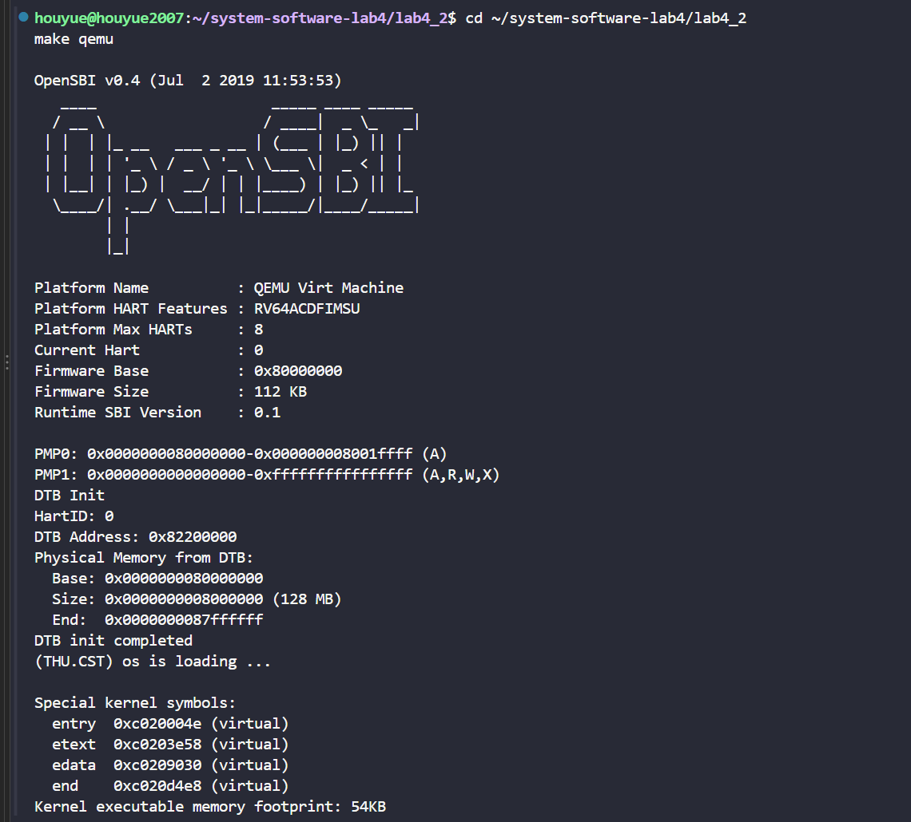
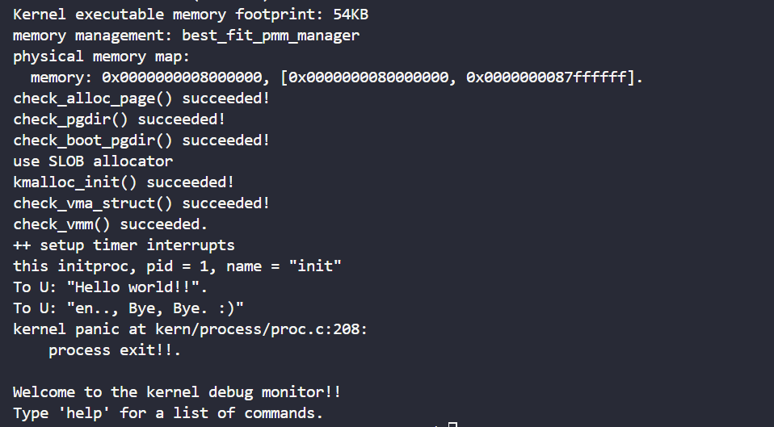
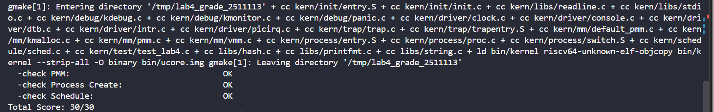

# 实验报告

## 实验基本信息

| 项目   | 内容                                |
| ---- | --------------------------------- |
| 实验名称 | Lab 4：进程管理                        |
| 小组成员 | 2512256-付佳、2512322-丁心怡、2511113-侯悦 |
| 完成日期 | 2026-11-14                        |

### 小组分工

| 成员          | 编程任务                          | 报告材料与核对任务                        |
| ----------- | ----------------------------- | -------------------------------- |
| 2512256-付佳  | 页映射，以及从前序实验接入物理内存、启动与 Trap 基础 | 提供页映射的设计、提示词约束、问题修正和验证记录，核对本模块说明 |
| 2512322-丁心怡 | 进程创建与初始化                      | 提供六个函数的提示词与交接说明，核对本模块说明          |
| 2511113-侯悦  | 进程调度、上下文切换与整组集成验证             | 提供调度模块说明、QEMU 和评分证据，汇总报告         |

---

## 一、实验目的

1. 理解物理页、页表项、引用计数和 TLB 的关系，实现线性地址到物理页的基本映射和撤销。
2. 理解进程控制块、内核栈、中断帧和上下文的用途，创建并初始化内核线程。
3. 理解空闲线程、可运行状态、轮转调度和寄存器上下文切换，使第一个内核线程获得 CPU。
4. 将实验要求写成可检查的 spec 与 AI 提示词，并用编译、QEMU 和课程评分脚本检验结果。

---

## 二、实验环境

| 类别    | 环境                                    |
| ----- | ------------------------------------- |
| 开发环境  | Windows、WSL Ubuntu、VS Code            |
| 目标架构  | RISC-V RV64，Sv39 页表                   |
| 构建工具  | Make、`riscv64-unknown-elf-gcc` 工具链    |
| 运行与调试 | `qemu-system-riscv64`、`gdb-multiarch` |
| 验证    | `make`、`make qemu`、`make grade`       |

### AI 编程工具

| 成员          | AI 编程工具                   | 底层模型                | 使用范围     |
| ----------- | ------------------------- | ------------------- | -------- |
| 2512256-付佳  | ChatGPT Work 中的 Codex     | GPT-6.1-sol         | 公共基础与页映射 |
| 2512322-丁心怡 | 命令行配置的 AI 工具              | DeepSeek-V4.1-Flash | 进程创建与初始化 |
| 2511113-侯悦  | VS Code 中的 Claude Code 面板 | Deepseek-flash High | 调度和上下文切换 |

本实验使用 AI 辅助阅读现有接口、生成指定区域内的实现，再用真实编译、运行和评分输出检查结果。模型给出的说明本身不作为测试通过的证据。

---

## 三、实验整体逻辑分析

### 3.1 本章节的逻辑主线

本实验围绕“让内核从能够管理内存，发展到能够创建和切换内核线程”展开。系统必须先建立可靠的物理页分配与页表映射，才能为线程分配内核栈并设置执行环境；然后创建进程控制块，记录线程状态、页表和执行现场；最后由调度器选择可运行线程，通过上下文切换把 CPU 交给它。

主路径是 `kern_init()` → `pmm_init()` → `vmm_init()` → `proc_init()` → `cpu_idle()` → `schedule()` → `proc_run()` → `switch_to()`。其中 `proc_init()` 建立 `idleproc` 和 `initproc`；`idleproc` 检查 `need_resched` 后请求调度；`schedule()` 从普通进程链表选择 `PROC_RUNNABLE` 线程；`proc_run()` 更新 `current` 和 Sv39 `satp`；`switch_to()` 保存旧线程并恢复新线程的寄存器上下文。新线程首次运行时，预先设置的 `ra` 引导其经过 `forkret`、`forkrets` 和 `__trapret` 进入线程入口。

### 3.2 功能的逐步实现

1. **准备内存映射。** 接入物理页分配器，维护页表项、物理页引用计数和 TLB。后续内核栈分配、启动过渡和线程运行都依赖可用的内存环境。
2. **创建线程对象。** 初始化 `proc_struct`、链表和 PID；为普通内核线程分配内核栈，准备 `trapframe` 与 `context`。此时系统有了可供调度的 `initproc`。
3. **实现调度与切换。** `cpu_idle()` 持续等待调度请求，`schedule()` 轮转寻找就绪线程，`proc_run()` 切换当前线程和页表，`switch_to()` 完成寄存器上下文转移。调度器至此能把 CPU 从 `idleproc` 交给 `initproc`。

这三个模块有明确的交接依赖：页映射完成后才能可靠建立线程资源；线程创建完成后调度器才有合法对象；最后进行整组 QEMU 与评分验证。

---

## 四、实验内容与实现

### 功能模块一：虚拟内存页操作

**负责人：** 2512256-付佳

#### 模块功能描述

**需要实现的函数：**

```c
int page_insert(pde_t *pgdir, struct Page *page, uintptr_t la, uint32_t perm);
void page_remove(pde_t *pgdir, uintptr_t la);
```

`page_insert()` 在 Sv39 页表中建立或更新给定线性地址的物理页映射；`page_remove()` 撤销已有映射。我们还把前序实验的 Best-Fit 分配器接到当前工程的 `default_pmm_manager`，完善 `page_init()`、启动映射和 Trap 恢复链路，使这两个接口有可运行的基础。

**核心实现与边界：** `page_insert()` 调用 `get_pte(..., 1)` 获取或分配页表项。获取失败返回 `-E_NO_MEM`；新映射增加目标页引用计数；替换映射时在更新页表项、使 TLB 失效后扣减旧页引用，旧页引用归零才释放。同一物理页只改变权限时不重复增减引用。`page_remove()` 对未映射地址直接返回；对有效映射清除页表项、使 TLB 失效，再扣减引用。`get_pte()` 在中间页表分配失败时回收本次已取得的目录页，避免留下半成品结构。

#### 本模块的 spec

| 场景       | 预期结果                          |
| -------- | ----------------------------- |
| 地址未映射    | 建立页表项，目标页引用加一，刷新对应 TLB；成功返回 0 |
| 已映射同一页   | 更新权限，引用计数不变                   |
| 已映射另一页   | 建立新映射并增加新页引用，扣减旧页引用；旧页引用归零时释放 |
| 删除有效映射   | 清除页表项、刷新 TLB、扣减原页引用           |
| 删除不存在的映射 | 安静返回，不改变物理页状态                 |
| 页表页分配失败  | 返回 `-E_NO_MEM`，不保留部分建立的映射     |

**依赖与保证：** 使用现有 `get_pte()`、`pte_create()`、`pte2page()`、页引用计数和 TLB 接口；保持 `page_insert()`、`page_remove()` 的公开签名及 `LAB4 function1 2512256` 标记。预期页表项内容、引用计数和 TLB 状态一致。

#### 最终提示词

如下：

```text
[PROMPT]
以当前 Lab4 工程为底稿，只在页映射模块和必要的前序实验基础处补全实现。接入 Lab2 的 Best-Fit、Lab3 的内存与 Trap 启动代码，在 LAB4 function1 实现 page_insert 和 page_remove，保留并填写 2512256 标记。先检查当前工程接口，再修改实际文件，给出修改清单和真实验证结果。

[RELY]
使用当前工程的 default_pmm_manager、default_pmm.h、Page 描述符、get_pte、pte_create、pte2page、page_ref_inc/page_ref_dec、free_page、tlb_invalidate 与 Sv39 地址宏。对照已有 page_init、boot_pgdir 和 Trap 返回路径，不能直接照搬旧实验的地址或管理器名称。

[GUARANTEE]
不改变 page_insert/page_remove 的公开接口，不增加重复的物理页管理器。保留原有自检，维持启动时低地址取指过渡和高地址内核映射，使时钟中断在 Lab4 继续工作。只根据真实编译或运行输出报告结果。

[SPECIFICATION]
page_insert：对未映射、同页权限更新、换页三种情况分别维护页表项和引用计数；分配失败返回 -E_NO_MEM，清理本次中间页表分配；页表修改后执行适当 TLB 失效。
page_remove：对无映射地址直接返回；对有效映射先清项并刷新 TLB，再扣减物理页引用，归零时释放。
使用当前 RV64/Sv39 的页表结构和物理地址约定，编译相关目标并记录实际输出。
```

#### 实现迭代过程

交接记录保存了关键修正，但未给出可核实的 AI 对话总轮次，因此按问题与修正记录：

1. **管理器接口不匹配。** 迁移代码引用了包中不存在的 `best_fit_pmm.h`，而当前启动代码使用 `default_pmm_manager`。我们改为使用现有 `default_pmm.h` 和管理器接口，避免重复实现分配器。
2. **启动映射不完整。** 刚写入 `satp` 时，下一条指令仍从低地址取指；只保留高地址内核映射会妨碍过渡。我们补上低地址恒等映射，并继续保留高地址映射。
3. **页表分配失败清理。** 原 `get_pte()` 在第一张目录页分配后立即发布目录项，后续失败可能留下空目录页。我们调整发布和回收顺序，处理分配失败后的清理与 TLB 刷新。
4. **跨实验时钟行为。** 旧实验达到指定打印次数后关机的逻辑不适合本实验；我们保留持续计时与中断处理，使调度和后续运行能够继续。

这一阶段完成了 RV64 前端、汇编目标、宿主机模拟和 WSL 目标编译检查；整组运行与评分在三个模块汇合后完成。对应提示词集中在 ../prompt/prompt_2512256_付佳.md。

### 功能模块二：进程创建与初始化

**负责人：** 2512322-丁心怡

#### 模块功能描述

**需要实现的函数：**

```c
static struct proc_struct *alloc_proc(void);
void proc_init(void);
int kernel_thread(int (*fn)(void *), void *arg, uint32_t clone_flags);
int do_fork(uint32_t clone_flags, uintptr_t stack, struct trapframe *tf);
static void copy_thread(struct proc_struct *proc, uintptr_t esp, struct trapframe *tf);
static int copy_mm(uint32_t clone_flags, struct proc_struct *proc);
```

`alloc_proc()` 分配并清空 PCB 的各个字段；`proc_init()` 初始化进程链表、哈希链表、`idleproc` 和 `initproc`；`kernel_thread()` 构造供 `do_fork()` 使用的初始中断帧；`do_fork()` 分配内核栈、设置线程资源、登记 PID 并唤醒；`copy_thread()` 在新线程的内核栈顶建立中断帧及首次切换用的 `context`；`copy_mm()` 在本实验内核线程场景中保持 `mm == NULL`，不复制用户地址空间。

**关键路径：** `idleproc` 的 PID 是 0，直接使用启动栈，不作为普通节点加入 `proc_list`。`initproc` 通过 `kernel_thread()` 和 `do_fork()` 创建，获得 PID 1。新线程的 `context.ra` 指向 `forkret`，`context.sp` 指向其 `trapframe`；第一次被切换到时，从 `forkret` 经 `forkrets`、`__trapret` 到 `kernel_thread_entry`，最终执行目标函数。

#### 本模块的 spec

| 函数                | 前置条件与结果                                               |
| ----------------- | ----------------------------------------------------- |
| `alloc_proc()`    | 内存分配器可用；返回字段和链表节点均已初始化的 PCB，失败返回 `NULL`               |
| `proc_init()`     | 内存管理已初始化；完成全局链表、`idleproc`、`current` 和 `initproc` 的建立 |
| `kernel_thread()` | 函数入口和参数有效；构造正确特权级与中断状态的中断帧，返回新线程 PID 或错误码             |
| `do_fork()`       | 进程管理结构已建立；按分配顺序创建资源、登记并唤醒，失败时回收已申请资源                  |
| `copy_thread()`   | 新 PCB 和内核栈可用；在栈顶放置中断帧，设置首次恢复入口和栈指针                    |
| `copy_mm()`       | 当前只创建内核线程；不复制用户地址空间，维持内核线程的地址空间约定                     |

**依赖与保证：** 使用 `proc_struct`、`context`、`trapframe`、`kmalloc`、内核栈分配、链表、PID 与 `forkret` 等现有接口；保持六个函数签名和 `LAB4 function2 2512322` 标记，不改页映射模块。

#### 最终提示词

如下：

```text
[PROMPT]
根据当前 Lab4 工程完成进程创建与初始化。先阅读 proc.c、proc.h、trapframe 定义和已有汇编入口，只修改 proc.c 的 LAB4 function2 区域；保留已完成的页映射代码。完成后说明六个函数的实现、执行链和实际发现的问题。

[RELY]
使用现有 proc_struct、context、trapframe、kernel_thread_entry、forkret、forkrets、__trapret，以及内存分配、链表、PID 和 sstatus 位定义。以当前工程与实验指导书的接口为准。

[GUARANTEE]
完成 alloc_proc、proc_init、kernel_thread、do_fork、copy_thread、copy_mm。必要时仅增加模块内部 static 辅助函数，不改变其他模块的公开接口或已完成的页映射。

[SPECIFICATION]
alloc_proc：初始化状态、PID、运行次数、内核栈、父进程、mm、context、tf、pgdir、标志、名称数组及两个链表节点。
proc_init：初始化全局链表；建立 PID 0 的 idleproc 并设置 current；通过 kernel_thread 建立 initproc。
kernel_thread：设置入口函数、参数、SPP、SPIE，并清除 SIE；调用 do_fork。
do_fork：依次分配 PCB 与内核栈、处理 mm、构造现场、分配 PID、登记链表、唤醒；任何中间失败都清理已申请资源。
copy_thread：在新线程栈顶保存 trapframe，设置子线程返回值、初始栈，以及 context.ra=forkret、context.sp=trapframe。
copy_mm：本实验不复制用户地址空间，维持内核线程的 mm 约定。
```

#### 实现迭代过程

交接材料记录了三项明确的修正，未记录每次生成的原始错误输出或对话轮次：

1. **名称数组初始化。** 用 `sizeof(proc->name)` 清空整个名称数组，避免仅清理指针大小或部分元素。
2. **链表节点初始化。** 分别对 `list_link` 和 `hash_link` 使用 `list_init()`，使新 PCB 在挂接前处于可用状态。
3. **初始中断状态。** 构造内核线程中断帧时设置 `SSTATUS_SPP`、`SSTATUS_SPIE` 并清除 `SSTATUS_SIE`，与首次恢复路径一致。

本模块在交接阶段完成代码对照；最终由整组 `make grade` 的 Process Create 检查验证。对应提示词集中在 ../prompt/prompt_2512322_丁心怡.md。

### 功能模块三：进程调度与上下文切换

**负责人：** 2511113-侯悦

#### 模块功能描述

**需要实现的函数：**

```c
void cpu_idle(void);
void schedule(void);
void proc_run(struct proc_struct *proc);
void switch_to(struct context *from, struct context *to);
```

`cpu_idle()` 持续检查当前线程的 `need_resched`；`schedule()` 从 `proc_list` 中轮转选出就绪线程；`proc_run()` 在保存原中断状态的临界区内更新 `current`、写入 RV64 Sv39 的 `satp` 并刷新 TLB；`switch_to()` 保存旧线程的 `ra`、`sp`、`s0` 至 `s11`，从新线程的 `context` 恢复同一组寄存器并 `ret`。

调度器从 `idleproc` 出发时从链表头后面查找；从普通线程出发时从其后继节点查找。遍历时跳过表头及非 `PROC_RUNNABLE` 节点；一圈内没有其他可运行线程时，优先继续运行仍可运行的当前普通线程，否则回到 `idleproc`。只有目标与当前线程不同，才调用 `proc_run()`；运行次数在 `schedule()` 中增加一次。

#### 本模块的 spec

| 函数            | 前置条件、保证与边界                                                                                 |
| ------------- | ------------------------------------------------------------------------------------------ |
| `cpu_idle()`  | `current` 已指向 `idleproc`；永远循环，看到 `need_resched` 非零才调用 `schedule()`                         |
| `schedule()`  | 链表已初始化，`idleproc` 不在普通链表；保护中断状态、清调度标志、最多扫描一圈、跳过表头与非就绪节点，空链表时可回退 `idleproc`                 |
| `proc_run()`  | 目标 PCB 有有效 `context`、内核栈和物理页表根；目标等于 `current` 时直接返回，否则以 64 位 Sv39 格式写 `satp`，刷新 TLB 并切换上下文 |
| `switch_to()` | `a0` 指向旧 `context`、`a1` 指向新 `context`；按 RV64 每项 8 字节的布局保存与恢复 14 个寄存器，最后 `ret`              |

**依赖与保证：** 使用已有 `proc_list`、`idleproc`、`current`、`le2proc`、`local_intr_save/restore`、`write_csr` 和 `flush_tlb`；不改变 `struct context` 布局，不写旧的 RV32 `lsatp()`，不修改测试、评分或其他模块。保留三处 `LAB4 function3 2511113` 标记。

#### 最终提示词

如下：

```text
[PROMPT]
先阅读当前 Lab4 工程中 proc.c、sched.c、switch.S、proc.h、sched.h、sync.h、riscv.h、pmm.c 和测试文件。只在 kern/process/proc.c、kern/schedule/sched.c、kern/process/switch.S 三处 LAB4 function3 区域实现 cpu_idle、proc_run、schedule、switch_to；把该三处标记的 YOUR CODE 替换为 2511113。展示逐文件 diff 和真实验证命令及结果。

[RELY]
idleproc 不在普通 proc_list；proc_init 已设置 current=idleproc、idleproc->need_resched=1；新线程的 context.ra=forkret、context.sp=proc->tf。struct context 依次为 ra、sp、s0 到 s11，共 14 个 uintptr_t，RV64 偏移为 0、8、16、…、104。proc->pgdir 是物理页表根地址；enable_paging() 提供 Sv39 satp 写法。测试线程会主动调用 schedule()。

[GUARANTEE]
保持四个函数原有签名、struct context 和 trapframe 布局。保留现有进程创建及页映射实现；不改 Makefile、tools、评分脚本或其他实验模块；不添加时钟抢占、进程退出回收或用户进程。不得用编译成功代替 QEMU 和评分结果。

[SPECIFICATION]
cpu_idle：无限循环，在 current->need_resched 非零时调用 schedule，不在函数内无条件关开中断。
schedule：保存并关闭中断，清 current->need_resched；从当前普通线程后继或 idleproc 对应的链表头后继开始，轮转查找 PROC_RUNNABLE；跳过链表头并最多扫描一圈；找不到其他可运行线程时选择当前可运行线程或 idleproc；只给被选目标的 runs 加一次，目标不同时调用 proc_run，最后恢复原中断状态。
proc_run：目标为 current 时直接返回；否则保存原中断状态及旧 current，更新 current；构造 ((uintptr_t)SATP_MODE_SV39 << 60) | (proc->pgdir >> RISCV_PGSHIFT)，写 satp 并刷新 TLB；调用 switch_to(&prev->context, &proc->context)，线程重新获得 CPU 后恢复进入时的中断状态。
switch_to：a0/a1 分别是旧/新 context；按 0 到 104 字节偏移保存旧 ra、sp、s0-s11，再从新 context 恢复相同寄存器，最后 ret；不保存 Trap CSR，不执行 sret。
完成后依次编译三个目标、运行 make，检查 switch.o 反汇编中的 14 次保存和 14 次恢复，再运行 make qemu 与 make grade，报告原始结果。
```

#### 实现迭代过程

1. **限定改动范围。** AI 在三个 `function3` 位置补全四个函数，未改进程创建、内存管理或测试文件。目标文件和完整内核编译成功；反汇编检查到 14 条保存、14 条恢复与 `ret`。
2. **运行路径核对。** `make qemu` 显示页表和内存检查通过，随后打印 `this initproc, pid = 1, name = "init"` 及两行 `To U`，证明内核线程创建并切换到了入口函数。
3. **课程评分。** 在同一源码版本上运行课程评分脚本，PMM、Process Create、Schedule 三项均为 OK，总分 30/30。验证时使用 gdb-multiarch 并显式加载 bin/kernel；没有修改实验源码或评分脚本。

QEMU 中 `initproc` 输出结束后的 `process exit!!` 来自当前实验框架的 `do_exit()` 未实现分支。它发生在上述目标输出之后；本实验未额外实现进程退出和回收。

### 扩展练习思考

**中断状态的保存与恢复。** `local_intr_save(flag)` 读取当前 `sstatus.SIE`，若原本允许中断，就关闭中断并把 `flag` 记为真；若原本已关闭，`flag` 为假。`local_intr_restore(flag)` 只在 `flag` 为真时重新允许中断。嵌套使用时，内层不会意外打开外层已关闭的中断。这是当前 hart 的中断状态保护，不等于多核互斥锁。

**分页模式与 `get_pte()`。** Sv32、Sv39、Sv48 都按虚拟页号的各级索引逐层查找页表，缺少中间页表时才按请求分配；它们分别使用二级、三级、四级页表，虚拟地址宽度和索引划分也不同。当前工程采用 RV64/Sv39 的三级页表。将“查找”和“按需创建”放在同一个 `get_pte()` 中可复用遍历路径，但调用者必须明确 `create` 参数，并处理分配失败与回滚；若以后引入更复杂的权限和并发要求，再拆分接口也有理由。本实验没有实现其他分页模式的代码。

---

## 五、测试与验证

### 5.1 构建与 QEMU 运行

我们先编译调度模块的三个目标，再执行完整 `make`。目标文件和内核镜像成功生成。课程 `make qemu` 启动 OpenSBI 与内核，内存管理、自检、虚拟内存检查、时钟初始化和 `initproc` 输出依次出现。



图1显示实际执行的 `make qemu` 命令及 QEMU/OpenSBI 启动过程。



图2中的 `check_alloc_page()`、`check_pgdir()`、`check_boot_pgdir()`、`check_vma_struct()` 和 `check_vmm()` 均显示成功；`initproc` 输出符合实验预期。末尾 `process exit!!` 是现有 `do_exit()` 的未实现路径，发生在上述输出之后，不作为“正常退出”描述。

### 5.2 课程评分

评分使用课程原有 `make grade` 和 `tools/grade.sh`，没有修改测试文件或评分脚本。整理后的目录中，可在 lab4 根目录使用以下命令复现，并让 `gdb-multiarch` 在启动时加载内核可执行文件：

```bash
cd code
set -o pipefail
make grade GDB='gdb-multiarch -se bin/kernel' GRADE_TMP=/tmp/lab4_grade_2511113 \
  2>&1 | tee ../report/logs/2511113_grade_gdb.log
```

| 检查项            | 结果        | 分值        |
| -------------- | --------- | ---------:|
| PMM            | OK        | 10/10     |
| Process Create | OK        | 10/10     |
| Schedule       | OK        | 10/10     |
| 总分             | **30/30** | **30/30** |



图3和最终日志对应有效评分。

---

## 六、实验总结与收获

### 对操作系统的理解

| 本实验中的知识点                               | OS 原理中的对应概念       | 关系与差异                                                                               |
| -------------------------------------- | ----------------- | ----------------------------------------------------------------------------------- |
| `page_insert()`、`page_remove()` 与页引用计数 | 虚拟内存、地址转换、物理页生命周期 | 页表项决定虚拟地址指向哪一页；引用计数决定物理页能否释放。本实验建立基本映射，尚未实现按需缺页与页面置换。                               |
| `proc_struct`、`trapframe`、`context`    | 进程/线程控制块与执行现场     | PCB 保存线程长期状态；`trapframe` 保存异常或首次进入时的寄存器现场；`context` 保存线程切换所需的被调用者保存寄存器。二者用途和保存范围不同。 |
| `idleproc`、`initproc`、`PROC_RUNNABLE`  | 空闲任务、线程状态与就绪队列    | 空闲任务保证没有普通线程可运行时仍有执行对象；普通线程通过状态和链表参与选择。当前代码把内核线程也统一表示为 `proc_struct`。               |
| `schedule()` 与 `switch_to()`           | 调度策略与机制分离         | `schedule()` 决定运行谁，`switch_to()` 只负责寄存器状态迁移；`proc_run()` 连接调度选择、页表切换和上下文切换。         |
| `local_intr_save/restore`              | 临界区与中断状态          | 保存进入前的中断状态并在返回时恢复，避免切换期间状态不一致；它只控制本 hart 的中断，不能替代多核锁。                               |

在 OS 原理中同样重要、但本实验没有完成的内容包括用户态进程隔离与系统调用、缺页异常和页面置换、写时复制、完整的 `exit/wait` 资源回收、多核同步以及更复杂的抢占式调度策略。`initproc` 输出后的退出 panic 正好说明退出回收尚未进入本次实现范围。

### AI 协作开发的经验

我们发现，提示词必须写清楚实际工程接口、修改边界、前置条件、后置条件和失败路径。旧实验代码可以提供思路，但直接搬运旧头文件名、页表地址或时钟行为会产生兼容问题。进程创建模块需要明确 PCB 各字段及首次恢复链；调度模块需要明确 `idleproc` 不在普通链表、Sv39 `satp` 的 64 位编码及 `context` 的 14 个槽位。

验证时，我们区分了编译、实际运行和评分三种证据。编译通过只证明目标可构建；QEMU 输出证明内核到达 `initproc`；评分脚本的结果还取决于本机 GDB 与 QEMU 的连接。加载内核符号后评分显示 `30/30`。

---

## 附：提交目录中的验证材料

- `../prompt/`：三名成员各自的四段式提示词。
- `./logs/2511113_grade_gdb.log`：最终 30/30 课程评分的原始日志。
- `./images/`：报告中引用的三张终端截图。
